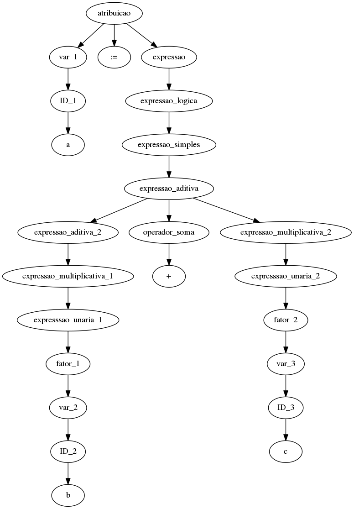
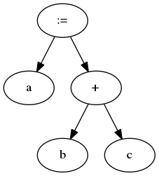

## Projeto de Implementação de um Compilador para a Linguagem **TPP**
### Geração de Código (Trabalho -- 4a. parte)

#### Prof. Rogério Aparecido Gonçalves

> __Resumo:__ _Este documento apresenta a especificação da 4a. e última parte do trabalho de implementação da disciplina. O objetivo nessa etapa é projetar e implementar a fase de *Geração de Código* do compilador para a linguagem **TPP**. O código a ser gerado é o LLVM-IR (código intermediário) utilizando as APIs do projeto LLVM._

# Geração de Código

Esta é 4a. e última fase de implementação do compilador `TPP`. O objetivo nessa etapa é projetar e implementar a fase de Geração de Código para a linguagem `TPP`. O código a ser gerado é o código intermediário `LLVM-IR` utilizando a `API` do projeto [`LLVM`](https://llvm.org/) através da biblioteca `Python` [`llvmlite`](https://llvmlite.readthedocs.io/en/latest/).

## Instruções Gerais

1. Para obter o código inicial para a quarta fase, __Geração de Código__. Se não fez a configuração do repositório oficial do professor como `upstream` na primeira parte, faça a configuração. Esse configuração deve ser feita apenas uma vez, conforme o @lst:comandos:iniciais.

```{#lst:comandos:iniciais .bash caption="Comandos de configuração do repositório"}
# Conectar o repositório oficial do professor como 'upstream'.
git remote add upstream https://github.com/rogerioag/tppcompiler-code-start.git

# Obter os arquivos para a fase 4, Geração de Código.
git fetch upstream
git merge upstream/main -m "Merge upstream Fase 4 - Geração de Código"
git push origin main
```

2. Siga a estrutura fornecida para desenvolver o trabalho, pois será a mesma estrutura que deverá ser entregue ao final do projeto.

Se a obtenção do código da nova fase funcionou, o diretório: `src/tppcodegen/` foi adicionado ao repositório do seu projeto, é nesse diretório que tem os arquivos que você irá trabalhar na geração de código. Ao terminar a implementação envie para o seu `github`, conforme o @lst:comandos:envio.

```{#lst:comandos:envio .bash caption="Comandos de envio para o github"}
git add .
git commit -m "feat: Implementação da Geração de Código"
git push origin main
```

3. Após o envio para o seu `github`, acesse o link <https://github.com/<seulogin-github/tppcompiler-seulogin-github/actions> e verifique o resultado da execução dos testes. Se algum teste falhar, corrija o problema e repita o processo. Os testes podem ser executados localmente com o comando: `pytest -v tests/tppcodegen_test.py`.

4. Prepare o relatório com a descrição do trabalho e da implementação e exemplos de entrada e saída gerada pela Geração de Código.

5. Deverá ser entregue o repositório compactado via moodle, conforme descrito na [Seção @sec:tpp:doc:entrega]. Com o código fonte da implementação completa e o relatório em **pdf** no formato de artigo conforme o modelo descrito na [Seção @sec:tpp:doc:entrega].

6. O projeto deve seguir a estrutura de diretórios e arquivos, disponível no repositório.

7. O relatório dessa quarta fase, deve conter o conteúdo das partes, Análise Léxica, Análise Sintática e Análise Semântica, e conteúdo relacionado a esta quarta fase, Geração de Código, incluindo exemplos de entrada e saída gerada pela Geração de Códgio.


## Implementação

Este é o enunciado da última parte do trabalho, que trata sobre a geração do código intermediário **LLVM**. A análise semântica produz uma árvore sintática abstrata anotada (ASTO). A __Tabela de Símbolos__ produzida por meio desta árvore anotada e a própria estrutura da árvore deve ser utilizada para a construção do código intermediário.

A implementação da _Geração de Código_ deverá ser realizando utilizando o mesmo conjunto de ferramentas compatíveis utilizado nas Análises Léxica, Sintática e Semântica. O código base para a implementação está disponível no link [Código Start da Geração de Código no Github](https://moodle.utfpr.edu.br/mod/url/view.php?id=1733902) do Moodle.

Na fase de geração de código intermediário (IR), a `ASTO` deverá ser percorrida novamente, classificando assim como a _"terceira passada"_ ou a _"segunda passada"_ do compilador, como foi comentado em sala de aula, para geração da IR. A linguagem alvo irá gerar a RI da LLVM **(LLVM-IR)** [@llvm:site][@llvmpy:site] [@kaleidoscope:site] [@paul:smith:2015] [@ian:bertolacci:2016] e todas as estratégias para a geração do código são apresentadas em sala de aula, além de materiais de apoio postados no moodle.

Ao criar o código para a chamada de função, o tipo dos parâmetros reais deve ser comparado com o tipo dos parâmetros formais. Essa análise é possível pois os parâmetros formais estão declarados na tabela de símbolos. Um erro/aviso deste tipo deverá ser do tipo semântico.

É esperado no fim desse trabalho que o código intermediário `LLVM-IR` seja gerado. Para a realização de otimizações, poderão ser aplicadas as configurações no ambiente de geração de código (API) do `LLVM`.

[Exemplos de Geração de Código LLVM](https://github.com/rogerioag/llvm-gencode-samples) estão disponíveis para cada situação, como por exemplo _declaração de variáveis_, _declaração e chamada de funções_ entre outros.

## Exemplo

Tomemos como exemplo uma atribuição ``a := b + c``, de acordo com a sintaxe da linguagem **TPP** temos a subárvore representada na Figura \ref{fig:atribuicao}.

{#id .class width=75% height=75%}

Após a verificação das regras semânticas na fase anterior, e a poda dos nós internos da árvore para facilitar a geração de código. A Figura \ref{fig:atribuicao:poda} apresenta a Árvore Sintática Abstrata simplificada.

{#id .class width=35% height=35%}

A sequência de operações (_loads_ de `b` e `c`, soma dos valores e _store_ do resultado em `a`) para a atribuição é apresentada na Figura \ref{fig:atribuicao:sequencia:operacoes}.

{width=100%}


O Código que deve ser gerado para uma ``atribuicao`` é apresentado no Código:

```.llvm
  %2 = load i32, i32* @b, align 4
  %3 = load i32, i32* @c, align 4
  %4 = add nsw i32 %2, %3
  store i32 %4, i32* @a, align 4
```


## Testes

Alguns casos de testes estão disponíveis no moodle institucional junto com essa especificação no código inicial fornecido. Pretende-se que o `Github` execute os testes automaticamente, porém a comparação do resultado esperado com o código gerado como referência é um tanto quanto complexa, pois teríamos a saída gerada pela ferramenta de compilação mais o código LLVM-IR gerado, além disso teríamos a saída do código executável gerado com o LLVM-IR gerado. Serão executados esses testes e outros testes que o professor julgar necessário durante a avaliação desta parte do trabalho.

* __GC:__ programa de exemplo `TPP` de **entrada** na linha de comando. 
* __Saída:__ Código `LLVM-IR` ou erros de fases anteriores e da geração de código.

No [Código Start da Geração de Código no Github](https://moodle.utfpr.edu.br/mod/url/view.php?id=1733902) tem um diretório `tests` com os testes para a _Geração de Código_.

É necessário desenvolver a parte da geração de código e fazer o tratamento de erros. A mesma classe de tratamento de erros está sendo utilizada em todas as fases do projeto, a `myerror.py` que carrega uma lista de erros composta por pares (chave:valor) formada por _códigos de erros_ e as _mensagens de erros_ correspondentes.

Nas fases anteriores provavelmente você alterou os arquivos relacionados à Análise Léxica, Sintática e Semântica, atualize o seu projeto para receber a versão inicial para o _Código de Start_ da Geração de Código.

### Código inicial da Geração de Código

O código inicial segue a mesma organização das fases anteriores (`src/tpplexer/`, `src/tppparser/` e `src/tppsema/`):

```text
src/tppcodegen/
├── __init__.py                       # Factory get_codegen e exportações
├── base.py                           # Classe base abstrata (BaseCodeGen)
├── CodeGenErrorMessages.properties   # Mensagens de erro e aviso da geração de código
└── llvm/                             # Estratégia padrão ("llvm"), usando llvmlite
    ├── __init__.py
    ├── tppcodegen.py                 # LLVMCodeGen: percorre a ASA e grava o '<arquivo>.tpp.ll'
    ├── context.py                    # ContextoLLVM: módulo, IRBuilder, tipos, escopos e funções (a implementar)
    └── emitters/                     # Emissão de LLVM-IR por categoria da linguagem (a implementar)
        ├── __init__.py
        ├── declarations.py           # Declarações de variáveis globais, locais e arranjos
        ├── functions.py              # Declaração de funções, chamadas e 'retorna'
        ├── commands.py               # Atribuição, 'se ... então ... senão' e 'repita ... até'
        ├── expressions.py            # Literais, variáveis, operadores e coerções de tipo
        └── io.py                     # Comandos 'leia' e 'escreva' (funções externas de E/S)
```

A Geração de Código é executada pelo `src/tpp_compiler.py` com a opção `--codegen llvm`, que executa antes as análises léxica, sintática e semântica. A geração de código só é executada quando a análise semântica não tem erros. O `LLVMCodeGen` recebe a árvore podada e a tabela de símbolos da semântica, prepara o `ContextoLLVM` e chama as funções de `emitters/` (`emitir_declaracao_variaveis`, `emitir_declaracao_funcao`, `emitir_comando`, `emitir_expressao`, `emitir_leia`, `emitir_escreva`, ...); os erros e avisos devem ser impressos por `codegen.emitir(chave, *args, linha=..., coluna=...)`, que trata a opção `-k`.

Para que os testes possam ser automatizados, o `Github` executa o `tests/tppcodegen_test.py` a cada `commit`. Para cada arquivo `<nome>.tpp` de `tests/codegen-tests/`, são executados três tipos de teste:

1. `test_execute` (saída do compilador): executa `src/tpp_compiler.py --codegen llvm -k <nome>.tpp` e compara a saída padrão com o arquivo `<nome>.tpp.codegen.out` (como os `.lex.out`, `.syn.out` e `.sem.out` das fases anteriores). Inclui também os casos de validação de entrada: arquivo não informado, extensão inválida e arquivo inexistente.
2. `test_llvm_ir` (LLVM-IR gerado): quando existe o arquivo de referência `<nome>.tpp.ll.out`, compara o `<nome>.tpp.ll` gerado com ele usando o `llvm-diff`.
3. `test_code_execution` (execução do código gerado): quando existe o arquivo `<nome>.tpp.ll.exe.out`, compila o `<nome>.tpp.ll` com o `clang`, executa o binário (usando `<nome>.tpp.in` como entrada padrão, se existir) e compara a saída com `<nome>.tpp.ll.exe.out`.

O @lst:testes:codegen mostra um trecho do arquivo de testes:

```{#lst:testes:codegen .python caption="Trecho do arquivo tests/tppcodegen_test.py"}
CODEGEN_TESTS_DIR = "tests/codegen-tests"

def test_execute(codegen_type, key_option, input_file):
    path_file = os.path.join(CODEGEN_TESTS_DIR, input_file) if input_file else ""
    cmd = "python src/tpp_compiler.py --codegen {0} {1} {2}".format(
        codegen_type, key_option, path_file
    )
    process = subprocess.Popen(
        shlex.split(cmd), stdout=subprocess.PIPE, stderr=subprocess.PIPE
    )
    stdout, stderr = process.communicate()

    expected_path = os.path.join(CODEGEN_TESTS_DIR, input_file + ".codegen.out")
    with open(expected_path, "r", encoding="utf-8") as output_file:
        expected_output = output_file.read()

    assert stdout.decode("utf-8").strip() == expected_output.strip()

def test_llvm_ir(codegen_type, input_file):
    path_file = os.path.join(CODEGEN_TESTS_DIR, input_file)
    generated_ll, expected_ll = path_file + ".ll", path_file + ".ll.out"

    cmd = [sys.executable, "src/tpp_compiler.py", "--codegen", codegen_type, "-k", path_file]
    compile_res = subprocess.run(cmd, capture_output=True, text=True)
    assert compile_res.returncode == 0, compile_res.stderr

    diff_res = subprocess.run(["llvm-diff", generated_ll, expected_ll],
                              capture_output=True, text=True)
    assert diff_res.returncode == 0 and diff_res.stdout.strip() == ""

def test_code_execution(codegen_type, input_file, tmp_path):
    path_file = os.path.join(CODEGEN_TESTS_DIR, input_file)
    generated_ll = path_file + ".ll"
    # ... gera o '.ll' como em test_llvm_ir ...

    exe_path = str(tmp_path / (input_file + ".ll.exe"))
    clang_res = subprocess.run(["clang", generated_ll, "-o", exe_path],
                               capture_output=True, text=True)
    assert clang_res.returncode == 0, clang_res.stderr

    run_res = subprocess.run([exe_path], input=stdin_data, capture_output=True, text=True)
    assert run_res.stdout.strip() == expected_output.strip()

# restante do arquivo foi suprimido.
```

Os testes podem ser executados localmente com `pytest -v tests/tppcodegen_test.py`. Os testes `test_llvm_ir` e `test_code_execution` precisam que o `llvm-diff` e o `clang` estejam instalados.

A ideia é que em uma _execução normal_ as mensagens de erros sejam recuperadas e impressas na saída padrão (terminal).

O arquivo `CodeGenErrorMessages.properties` foi atualizado com a seção de erros e avisos para a _Geração de Código_:

```text
[CodeGenErrors]
WAR-CODEGEN-OUTPUT-FILE=Output
WAR-CODEGEN-SUCCESS=Código Gerado com Sucesso.
ERR-CODEGEN-INESPERADO=Erro inesperado.
```

Na impressão feita pela classe `MyError`, que foi definida no arquivo `myerror.py`, a distinção entre erros e avisos deve ser feita.

## Documentação

Durante toda a disciplina o aluno criará uma documentação formal da implementação do compilador para a linguagem. Sendo os relatório com conteúdo acumulativo, isto é, as fases subsequentes irão complementar o conteúdo existente das fases anteriores. Neste ponto do trabalho o aluno deverá incluir na documentação:

- Explicar se houve alguma estratégia diferenciada para a geração do código `LLVM-IR`[^1];
- Explicar a(s) otimizações utilizadas na linguagem de programação; e
- Explicar como o compilador deverá ser executado.

O relatório deve ser escrito no formato de artigo[^2] disponível no [link](https://www.overleaf.com/read/fcqmjkfgktgt) que já vem sendo utilizado nas fases anteriores. O número páginas deve ser de $8$ a $12$ páginas em cada fase.

[^2]: [Formato para o relatório: https://www.overleaf.com/read/fcqmjkfgktgt](https://www.overleaf.com/read/fcqmjkfgktgt)


## Avaliação

Será avaliado se o compilador realiza todas as fases de compilação corretamente para um exemplo simples escrito pelo professor. O essencial da linguagem deve ser mantido (conforme especificado nos trabalhos anteriores) para que o mesmo exemplo funcione para testar todos os trabalhos com o mínimo de alteração.

- Serão avaliados, dentre outros critérios:
	a) Da implementação:

		* O funcionamento do programa.
		* O capricho e a organização na elaboração do projeto.
		* A corretude da implementação em relação ao que foi pedido no trabalho;
		* A colocação em prática dos conceitos que foram discutidos em sala de aula de forma correta;
		* A qualidade do projeto e da implementação (descrição e elaboração do projeto e o passo a passo da implementação);

 	b) Do relatório:

		* O conteúdo e a forma que foi apresentado, se o formato é o mesmo solicitado.
		* Organização das ideias e do processo de tradução.
		* O capricho na elaboração e na formatação do texto, bem como o conteúdo do texto.

- Não serão avaliados os trabalhos:
	a) Que chegarem fora do prazo;
 	b) Que não forem feitos nas ferramentas solicitadas;
 	c) Que não estão no formato especificado;
 	d) Que não foram compactados em um só arquivo;
 	e) Que não tiverem identificação (nome e matrícula);
 	f) Que forem cópias de outros trabalhos ou materiais da internet.
 	g) Que não seguirem todas estas instruções;

- Não se esqueça que o trabalho vale **10,0** e contribui para o cálculo da nota final.


## Entrega e apresentação

O trabalho será **individual** e deverá ser entregue até o dia **08/12/2026** no moodle da disciplina em um pacote compactado e apresentado no mesmo dia. Não haverá extensão de tempo, então se organizem para fazerem os trabalhos completamente.

A estrutura do projeto com os arquivos do projeto (fonte e relatório) deve ser compactada (zipados) e o arquivo compactado deve ser enviado pelo moodle utilizando a opção de submissão __"Trabalho 4a. parte - Geração de Código Intermediário"__, o nome do arquivo compactado deve seguir o padrão de nomes do formato.

Deverá ser especificado na entrega o mecanismo de execução da varredura para a realização da correção.

**Obs.:** Favor utilizar ZIP como forma de compactação.

## Leitura Recomendada

> [!IMPORTANT]
> **Leitura Recomendada**
>
>__Capítulo 8: Geração de Código__
>
>**Livro**: [```LOUDEN, Kenneth C. Compiladores: princípios e práticas. São Paulo, SP: Thomson, c2004. xiv, 569 p. ISBN 8522104220.```](https://integrada.minhabiblioteca.com.br/reader/books/8522104220/pageid/415)


[> [!IMPORTANT]
> **Leitura Recomendada**
>
>__Capítulo 6: Geração de Código Intermediário__
>
>**Livro**: [`AHO, Alfred V. et al. Compiladores: princípios, técnicas e ferramentas. 2. ed. São Paulo, SP: Pearson Addison-Wesley, 2008. x, 634 p. ISBN 9788588639249.`](https://integrada.minhabiblioteca.com.br/#/books/9788588639249/pageid/228)

> [!IMPORTANT]
> **Leitura Recomendada**
>
>__Capítulo 7: Forma de Código__
>
>**Livro**: [`COOPER, Keith D.; TORCZON, Linda. Construindo compiladores. Rio de Janeiro, RJ: Elsevier/Campus, 2014. xxiv, 656 p. ISBN 9788535255645. Disponível em: https://research.ebsco.com/linkprocessor/plink?id=debd0a1f-ba89-3ee8-b0a1-2c929486cc51. Acesso em: 12 mar. 2024.`](https://integrada.minhabiblioteca.com.br/#/books/9788535255645/pageid/283)

## _Word Cloud_

{ width=100% }

## Referências
