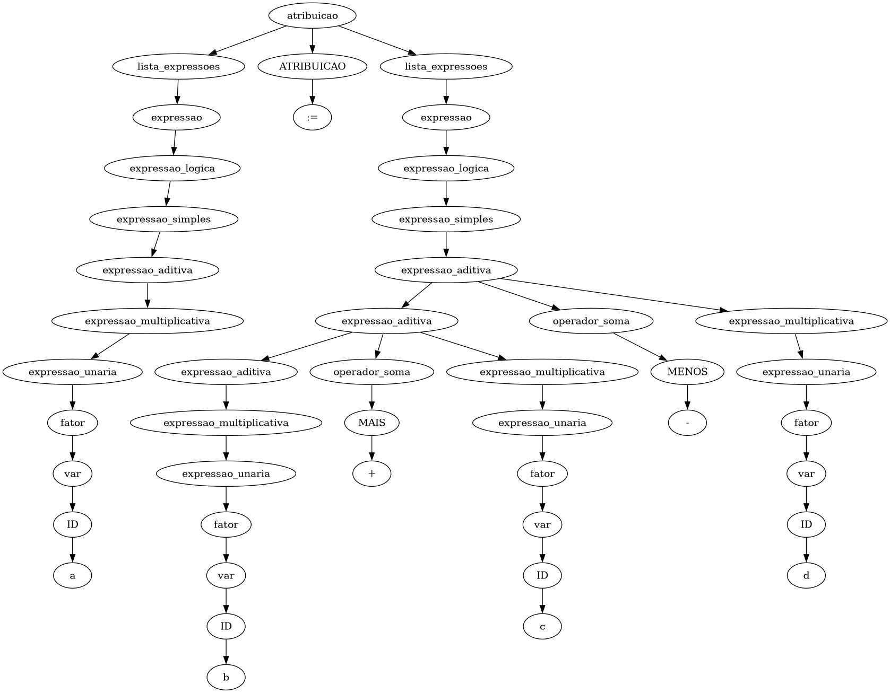
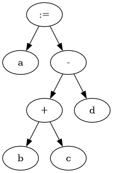

## Projeto de Implementação de um Compilador para a Linguagem **TPP**
### Análise Semântica (Trabalho -- 3a. parte)

#### Prof. Rogério Aparecido Gonçalves

> __Resumo:__ _Este documento apresenta a especificação da 2a. parte do trabalho de implementação da disciplina. O objetivo nessa etapa é projetar e implementar a fase de __Análise Semântica__ do compilador para a linguagem __TPP__._


# Análise Semântica

A __Análise Semântica__ consiste em uma _"segunda passada"_ do compilador no código, pois o código fonte é novamente analisado desde o início na **AST**, porém agora para realizar a anotação de atributos, inferência de tipos e verificações se as construções sintáticas fazem algum sentido para a linguagem.

Como entrada para a _Análise Semântica_ temos a Árvore Sintática Abstrata (AST) produzida pela fase anterior, a _Análise Sintática_ com a utilização da lista de _tokens_ identificados pela _Análises Léxica_ na construção da árvore sintática pela derivação das regras sintáticas da linguagem.

O principal motivo da Análise Semântica é verificar se existem erros de contexto para a linguagem. Um conjunto de Regras Semânticas devem ser verificadas.

## Instruções Gerais

1. Faça _download_ do arquivo do modelo de estrutura do trabalho e relatório disponível na página da disciplina no moodle. Descompacte e trabalhe nos arquivos e estrutura fornecida, pois será a mesma estrutura que deverá ser entregue ao final do projeto.

2. Siga a estrutura fornecida para desenvolver o trabalho.

3. O relatório deve ter a descrição do trabalho e dos programas, o código fonte dos programas, uma explicação sobre o funcionamento do programa, o processo de tradução com exemplos de instruções dos três formatos e um exemplo de execução do seu programa reproduzindo a saída gerada.

4. Deverão ser entregues:
	a) O código fonte dos programas.
	b) Relatório em **pdf** que pode ser feito no formato do `LibreOffice` ou no `Latex`.

5. O projeto deve seguir a estrutura de diretórios e arquivos, disponível no formato. A estrutura do projeto é apresentada na Figura \ref{fig:formato:entrega}.


## Implementação

Com as Análises Léxica e Sintática já concluídas, iremos realizar a verificação das __Regras Semânticas__ e espera-se ter como saída uma Árvore Sintática Abstrata (AST) podada.

A implementação da _Análise Semântica_ deverá ser realizando utilizando o mesmo conjunto de ferramentas compatíveis utilizado na Análise Léxica e Análise Sintática. O código base para a implementação está disponível no link [Código Start da Semântica no Github Classroom](https://moodle.utfpr.edu.br/mod/url/view.php?id=1733895) do Moodle.

Para a terceira parte do trabalho, a **AST** deve ser percorrida utilizando as informações da _Tabela de Símbolos_ iniciada na Análise Sintática. A análise semântica consiste da "segunda passada" do compilador no código, pois o código fonte é novamente analisado desde o início na **AST**, porém agora para realizar a sua anotação de atributos. A tabela de símbolos deve ser gerada/atualizada por meio das estratégias apresentadas em sala de aula.

O principal motivo da **Análise Semântica** é verificar se existem erros de contexto para a linguagem **TPP** apresentada na primeira e segunda parte deste trabalho.

## Regras Semânticas

As **Regras Semânticas** que precisam ser verificadas para a identicação de erros semânticos ou de contexto são:

> __Gramática TPP v1.1:__ a versão 1.1 da gramática ([docs/grammar/grammar.md](grammar/grammar.md)) acrescentou atribuição múltipla e encadeada, alvos entre parênteses (tuplas), retorno múltiplo, inicialização de arranjos e declaração com inicialização. O analisador sintático aceita algumas construções que só podem ser validadas na Análise Semântica; elas estão descritas nos itens 4.3 a 7. A estrutura da árvore produzida para essas construções está na seção [Árvore Sintática das extensões da TPP v1.1](#árvore-sintática-das-extensões-da-tpp-v11).

1. **Funções e Procedimentos:** Verificações relacionadas a funções e procedimentos.

	1.1. **Função Principal.** Todo programa escrito em **TPP** deve ter uma função __principal__ declarada que inicializa a execução do código. Verificar a existência de uma função com o nome de _"principal"_, se não existir deve apresentar a mensagem:
   
	__Tipo:__ Erro.

	__Chave:__ `ERR-SEM-MAIN-NOT-DECL`.

	__Mensagem:__ `Função 'principal' não declarada.`

	1.2. __Declaração de Função:__ Funções precisam ser declaradas antes de serem chamadas. Caso contrário a mensagem de erro deve ser emitida: 

	__Tipo:__ Erro.

	__Chave:__ `ERR-SEM-CALL-FUNC-NOT-DECL`.

	__Mensagem:__ `Chamada à função 'func' que não foi declarada.`
	
	1.3. __Identificador de Função:__ Uma função ou procedimento é identificado pelo seu tipo _retorno_, seu _nome_ e seus _parâmetros formais_. 
	
	A quantidade de _parâmetros reais_ de uma chamada de função/procedimento `func` deve ser igual a quantidade de _parâmetros formais_ da sua definição. Caso contrário, gerar as mensagens:
	
	__Tipo:__ Erro.

	__Chave:__ `ERR-SEM-CALL-FUNC-WITH-FEW-ARGS` ou `ERR-SEM-CALL-FUNC-WITH-MANY-ARGS`

	__Mensagem:__ `Chamada à função 'func' com número de parâmetros menor que o declarado.`

	__Mensagem:__ `Chamada à função 'func' com número de parâmetros maior que o declarado.`
	


	1.4. __Declarada e não utilizada:__ Uma função pode ser declarada e não utilizada. Se isto acontecer uma aviso deverá ser emitido:
	
	__Tipo:__ Aviso.
	
	__Chave:__ `WAR-SEM-FUNC-DECL-NOT-USED`.
	
	__Mensagem:__ `Função 'func' declarada, mas não utilizada.`.


	1.5. __Retorno de Função:__ Uma função deve retornar um valor de tipo compatível com o tipo de retorno declarado. 
	
	A função principal normalmente é do tipo `inteiro`, assim é esperado que seu retorno seja um valor `inteiro`, se não apresenta um `retorna(0)`, a mensagem deve ser gerada:
	
	__Tipo:__ Erro.
	
	__Chave:__ `ERR-SEM-FUNC-RET-TYPE-ERROR`.
	
	__Mensagem:__ `Função 'principal' deveria retornar 'inteiro', mas retorna 'vazio'`.
	
	Para as outros funções o tipo de retorno deve ser compatível com o declarado.
	
	Uma função qualquer não pode fazer uma chamada à função principal. Devemos verificar ser existem alguma chamada para a função principal partindo de qualquer outra função do programa.
	
	__Tipo:__ Erro.
	
	__Chave:__ `ERR-SEM-CALL-FUNC-MAIN-NOT-ALLOWED`.
	
	__Mensagem:__ `Chamada à função 'principal' não permitida.`
	
	Se a função principal fizer uma chamada para ela mesmo, a mensagem de aviso deve ser emitida:
	
	__Tipo:__ Aviso.
	
	__Chave:__ `WAR-SEM-CALL-REC-FUNC-MAIN`.
	
	__Mensagem:__ `Chamada recursiva para 'principal'.`


2. __Variáveis.__

	2.1. O **identificador de variáveis locais e globais**: nome, tipo e escopo devem ser aramazenados na Tabela de Símbolos. 
	Variáveis devem ser **declaradas** e **inicializadas**, antes de serem **utilizadas** (leitura).
	Lembrando que uma variável pode ser declarada:
    - no escopo do procedimento (como expressão ou como parâmetro formal).
    - no escopo global.

	Se houver a tentativa de leitura ou escrita de qualquer variável não declarada a seguinte mensagem:
	
	__Tipo:__ Erro.
	
	__Chave:__ `ERR-SEM-VAR-NOT-DECL`
	
	__Mensagem:__ `Variável 'a' não declarada.`

	
	Se uma variável 'a' for apenas declarada e não for inicializada (escrita). Se houver a tentativa de leitura de uma variável 'a' declarada, mas não inicializada:
	
	__Tipo:__ Aviso.
	
	__Chave:__ `WAR-SEM-VAR-DECL-NOT-INIT`
	
	__Mensagem:__ `Variável 'a' declarada e não inicializada.`


	Se uma variável 'a' for declarada e não for utilizada (não lida), o analisador deve gerar a mensagem:
	
	__Tipo:__ Aviso.
	
	__Chave:__ `WAR-SEM-VAR-DECL-NOT-USED`
	
	__Mensagem:__ `Variável 'a' declarada e não utilizada.`
	
	*Warnings* deverão ser mostrados quando uma variável for declarada mais de uma vez. Se uma variável 'a' for declarada duas vezes no mesmo escopo, o aviso deve ser emitido:
	
	__Tipo:__ Aviso.
	
	__Chave:__ `WAR-SEM-VAR-DECL-PREV`
	
	__Mensagem:__ `Variável 'a' declarada anteriormente com o tipo 'inteiro'.`

3. **Atribuição de tipos distintos e Coerções implícitas.** Na atribuição devem ser verificados se os tipos são compatíveis. *Warnings* deverão ser mostrados quando ocorrer uma coerção implícita de tipos (inteiro<->flutuante).

	Atribuição de variáveis ou de números ou de resultados de chamadas à funções ou resultados de expressões de tipos distintos devem gerar a mensagem:

	__Tipo:__ Aviso.
	
	__Chave:__ `WAR-SEM-ATR-DIFF-TYPES-IMP-COERC-OF-VAR`
	
	__Mensagem:__ `Atribuição de tipos distintos. Coerção implícita do valor de 'x' do tipo 'inteiro' para 'y' que é 'flutuante'.`


	__Tipo:__ Aviso.
	
	__Chave:__ `WAR-SEM-ATR-DIFF-TYPES-IMP-COERC-OF-NUM`
	
	__Mensagem:__ `Atribuição de tipos distintos. Coerção implícita do valor atribuído '5.0' do tipo 'flutuante' para 'x' que é 'inteiro'.`
	
	Por exemplo, uma variável `a` recebe uma expressão `b + c`. Os tipos declarados para `a` e o tipo resultado da inferência do tipo da expressão `b + c` deverão ser compatíveis. Se `b` for `inteiro` e `c` for `inteiro`, o tipo resultante da expressão será também `inteiro`.
	
	Se assumirmos, por exemplo, que `b` é do tipo `inteiro` e `c` do tipo `flutuante`, o resultado pode ser `flutuante` (se assumirmos isso para nossa linguagem). O que faria a atribuição `a := b + c` apresentar tipos diferentes e a mensagem deve ser apresentada:

	__Tipo:__ Aviso.
	
	__Chave:__ `WAR-SEM-ATR-DIFF-TYPES-IMP-COERC-OF-EXP`
	
	__Mensagem:__ `Atribuição de tipos distintos. Coerção implícita do valor de 'expressão' do tipo 'flutuante' para 'a' que é 'inteiro'.`
	
	O mesmo pode acontecer com a atribuição de um retorno de uma função, se os tipos forem incompatíveis o usuário deve ser avisado:
	
	__Tipo:__ Aviso.
	
	__Chave:__ `WAR-SEM-ATR-DIFF-TYPES-IMP-COERC-OF-RET-VAL`
	
	__Mensagem:__ `Atribuição de tipos distintos. Coerção implícita do valor retornado por 'func' do tipo 'inteiro' para 'y' que é 'flutuante'.`
	
	Se algum argumento de uma chamada de função for diferente do tipo declarado o aviso deve ser dado:
	
	__Tipo:__ Aviso.
	
	__Chave:__ `WAR-SEM-ATR-DIFF-TYPES-IMP-COERC-OF-FUNC-ARG`
	
	__Mensagem:__ `Chamada à função 'func' com Coerção implícita do valor do argumento tipo 'flutuante' diferente do parâmetro declarado 'inteiro'`	

4. **Arranjos.** Na linguagem `TPP` é possível declarar arranjos, pela sintaxe da linguagem o índice de um arranjo é inteiro e isso deve ser verificado. Na tabela de símbolos devemos armazenar se uma variável declarada tem um tipo, se é uma variável escalar ou um vetor ou uma matriz. Podemos armazenar um campo 'dimensões', que '0': escalar, '1': arranjo unidimensional (vetor) e '2': arranjo bidimensional (matriz) e assim por diante.

	4.1. Encontrado a referência a um arranjo, seu o índice, seja um número, variável ou expressão deve ser um `inteiro`. Do contrário, a mensagem deve ser gerada:

	__Tipo:__ Erro.
	
	__Chave:__ `ERR-SEM-ARRAY-INDEX-NOT-INT`

	__Mensagem:__ `Indice de array 'x' não 'inteiro'.`

	4.2. Se o acesso ao elemento do arranjo estiver fora de sua definição, por exemplo um vetor `A` é declarado como tendo `10` elementos (0 a 9) e há um acesso ao `A[10]`, a mensagem de erro deve ser apresentada: 
	
	__Tipo:__ Erro.
	
	__Chave:__ `ERR-SEM-ARRAY-INDEX-OUT-OF-RANGE`

	__Mensagem:__ `Indice de array 'A' fora do intervalo (out of range).`

	4.3. __Tamanho do arranjo na declaração.__ Na declaração (`inteiro: v[5]`), a expressão entre colchetes é o __tamanho__ da dimensão, e não um índice. Ela deve ser uma constante `inteiro` maior que zero:

	__Tipo:__ Erro.
	
	__Chave:__ `ERR-SEM-ARRAY-SIZE-NOT-CONST`

	__Mensagem:__ `Tamanho do arranjo 'v' deve ser uma constante inteira positiva.`

	A árvore permite distinguir os dois usos de `v[...]`: na declaração, a `var` está dentro de `lista_variaveis` (tamanho); numa atribuição ou expressão, está dentro de um `fator` (índice).

	4.4. __Inicialização de arranjos.__ Um inicializador (`{1, 2, 3}`, ou `{{1, 2}, {3, 4}}` para matrizes) pode aparecer na declaração (`inteiro: v[5] := {1, 2, 3, 4, 5}`), na inicialização global (`v := {1, 2}`) e em atribuições. O inicializador se ajusta à forma do alvo:

	- __Inicialização parcial:__ se o alvo tem mais posições que o inicializador, as restantes recebem `0`. `inteiro: v[5] := {1, 2}` equivale a `{1, 2, 0, 0, 0}`. Não gera mensagem.
	- __Alvo escalar:__ se o alvo é um elemento (`v[4]`) ou uma variável escalar, é usado o primeiro elemento: `v[4] := {1, 2}` equivale a `v[4] := 1`.
	- __Linha de matriz:__ com `inteiro: M[2][3]`, `M[0] := {1, 2}` preenche a linha 0 com `{1, 2, 0}`.
	- __Elementos excedentes:__ se o inicializador tem mais elementos que o alvo comporta (inclusive no caso do alvo escalar), os excedentes são descartados e o aviso deve ser emitido:

	__Tipo:__ Aviso.
	
	__Chave:__ `WAR-SEM-ARRAY-INIT-EXCESS-ELEMS`

	__Mensagem:__ `Elementos excedentes no inicializador de 'v' foram descartados.`

	Se o aninhamento do inicializador tiver mais níveis que as dimensões do alvo (por exemplo, `{{1, 2}}` para um vetor), a mensagem de erro deve ser emitida:

	__Tipo:__ Erro.
	
	__Chave:__ `ERR-SEM-ARRAY-INIT-DIM`

	__Mensagem:__ `Inicializador de 'v' tem mais dimensões que o arranjo.`

	O inicializador é um valor completo e não pode ser usado como operando de uma expressão (`x := {1} + 2`) nem como argumento de `escreva`:

	__Tipo:__ Erro.
	
	__Chave:__ `ERR-SEM-ARRAY-INIT-IN-EXP`

	__Mensagem:__ `Inicializador de arranjo não pode ser usado em uma expressão.`

	Os elementos do inicializador devem ser compatíveis com o tipo do arranjo; as coerções implícitas seguem as regras do item 3.

5. __Atribuição múltipla, encadeada e tuplas.__

	5.1. __Alvos da atribuição.__ Dentro das funções, o analisador sintático lê o lado esquerdo da atribuição como uma lista de expressões (como o Python), e por isso aceita `f() := 1`, `1 := x` e `a + b := c`. Cada alvo deve ser uma variável (`a`, `v[i]`, `M[i][j]`) ou uma tupla de variáveis (`(a, b)`). Caso contrário:

	__Tipo:__ Erro.
	
	__Chave:__ `ERR-SEM-ATR-INVALID-TARGET`

	__Mensagem:__ `Alvo inválido na atribuição: 'f()' não é uma variável.`

	No escopo global (`inicializacao_variaveis`) e nos elos de `atribuicao_encadeada` da declaração, o analisador sintático já só aceita variáveis como alvo.

	5.2. __Quantidade de alvos e de valores.__ Em `a, b := c, d`, a quantidade de alvos deve ser igual à de valores. Antes de comparar, cada lado deve ser normalizado:

	- se um lado tem um único elemento e ele é uma tupla, a tupla é desmontada nos seus elementos: `(a, b) := 1, 2` e `a, b := (1, 2)` têm dois alvos e dois valores;
	- se o lado direito é uma única chamada de função, a quantidade de valores é a quantidade de tipos de retorno declarados: `a, b := funct(10, 3)` com `(inteiro, flutuante) funct(...)` tem dois valores.

	Se as quantidades forem diferentes:

	__Tipo:__ Erro.
	
	__Chave:__ `ERR-SEM-ATR-DIFF-NUM-TARGETS-VALUES`

	__Mensagem:__ `Atribuição com 2 alvos e 3 valores.`

	Cada par alvo/valor é verificado individualmente pelas regras de tipos e coerções do item 3. Todo o lado direito é avaliado antes de qualquer alvo receber valor, de modo que `a, b := b, a` troca os valores de `a` e `b`.

	5.3. __Tuplas fora da atribuição.__ Uma tupla (`(a, b)`) só é permitida como lado inteiro de uma atribuição, isto é, como único alvo ou como único valor. Em qualquer outro lugar (`escreva((1, 2))`, `x := (1, 2) + 3`, argumento de função, condição de `se`), a mensagem deve ser emitida:

	__Tipo:__ Erro.
	
	__Chave:__ `ERR-SEM-TUPLE-NOT-ALLOWED`

	__Mensagem:__ `Tupla não permitida neste contexto.`

	5.4. __Atribuição encadeada.__ Em `a := b := 0` (dentro de funções) o valor é avaliado uma única vez e as atribuições são feitas da direita para a esquerda, do elo mais interno para o mais externo: primeiro `b := 0`, depois `a` recebe o valor de `b`. Cada elo é verificado pelas regras dos itens 3, 5.1 e 5.2.

	5.5. __Declaração com inicialização encadeada.__ Em `inteiro: a := b := 1`, apenas `a` é declarada. A variável `b` deve ter sido declarada antes; caso contrário, aplica-se `ERR-SEM-VAR-NOT-DECL` (item 2.1). As duas recebem `1`, com as verificações de tipos do item 3. Na declaração simples (`inteiro: a, b := 1, 2`), a quantidade de variáveis declaradas e de valores segue a regra 5.2.

6. __Retorno múltiplo.__ Uma função pode declarar vários tipos de retorno `(inteiro, flutuante) funct(inteiro: a, inteiro: b)` e retornar vários valores `retorna(q, r)`.

	6.1. A quantidade de valores de cada `retorna(...)` deve ser igual à quantidade de tipos declarados:

	__Tipo:__ Erro.
	
	__Chave:__ `ERR-SEM-FUNC-RET-NUM-ERROR`

	__Mensagem:__ `Função 'funct' deveria retornar 2 valores, mas retorna 1.`

	O tipo de cada valor é comparado com o tipo declarado na mesma posição, pelas regras do item 1.5.

	6.2. Uma chamada a uma função com mais de um retorno só pode aparecer como único valor do lado direito de uma atribuição (`q, r := funct(10, 3)`). Usada em uma expressão (`x := funct(10, 3) + 1`), como argumento ou em `escreva`, a mensagem deve ser emitida:

	__Tipo:__ Erro.
	
	__Chave:__ `ERR-SEM-CALL-FUNC-MULTI-RET-IN-EXP`

	__Mensagem:__ `Chamada à função 'funct', que retorna 2 valores, usada em uma expressão.`

7. __Expressões.__

	7.1. __Comando sem efeito.__ Uma expressão usada como comando só tem efeito se for uma chamada de função. Como os comandos terminam no fim da linha, `x := a` seguido de `+ b` na linha de baixo são dois comandos, e o segundo não faz nada. Também é o caso de `vet[i] = j`, uma comparação usada no lugar de `vet[i] := j`. Nesses casos, o aviso deve ser emitido:

	__Tipo:__ Aviso.
	
	__Chave:__ `WAR-SEM-EXP-STMT-NO-EFFECT`

	__Mensagem:__ `Expressão usada como comando não tem efeito.`

	7.2. __Comparações encadeadas.__ `a < b < c` é aceito pela sintaxe e equivale a `(a < b) < c`, que compara o resultado de uma comparação com `c`. O aviso deve ser emitido:

	__Tipo:__ Aviso.
	
	__Chave:__ `WAR-SEM-REL-CHAIN`

	__Mensagem:__ `Comparação encadeada: o resultado de uma comparação é comparado com outro valor.`

	7.3. __Precedência de `&&` e `||`.__ Na gramática, `&&` e `||` têm a mesma precedência e associam à esquerda: `a || b && c` é avaliado como `(a || b) && c`. A Análise Semântica e a Geração de Código devem respeitar a árvore produzida.

8. E outras situações descritas nos arquivos de testes.

Para a realização da análise dos erros apontados, a construção da **Tabela de Símbolos** deve ser realizada adequadamente. Uma Tabela de Símbolos pode começar a ser construída desde as análises anteriores. Por exemplo, na **Análise Léxica** temos os `TOKENS` e os _lexemas_ que casaram com a expressão regular que gerou cada um desses tokens. Temos também o número da linha e da coluna que o lexema foi encontrado no código fonte de entrada. Desta forma, as entradas da __Tabela de Símbolos__ podem ir sendo preenchidas com essas informações iniciais `<TOKEN, LEXEMA, LINHA, COLUNA>`.

Na **Análise Sintática** quando o reconhecimento entrar na função que trata a regra, por exemplo, na regra de `declaração de variáveis`, todas as variáveis da lista de identificadores irão assumir o tipo declarado:

``inteiro: a, b, c[10]``

Que entraria na regra:

```ebnf
declaracao_variaveis ::= tipo DOIS_PONTOS lista_variaveis
                         | tipo DOIS_PONTOS lista_variaveis ATRIBUICAO lista_expressoes
                         | tipo DOIS_PONTOS lista_variaveis ATRIBUICAO atribuicao_encadeada
```

A declaração indica que os elementos da `lista_variaveis`, que são as variáveis escalares `a` e `b` e o arranjo unidimensional `c` terão por declaração o `tipo` que no exemplo é `inteiro`.

### Tabela de Símbolos

Considere o código do Exemplo:

```.pascal
inteiro: a, b[10], c[3][5]

b := 10

inteiro func(inteiro: x, inteiro: y)
  inteiro: res
  res = x + y;
  retorna(res) 
fim

inteiro principal()
  leia(a)
  leia(b)

  b[0] := a
  b[1] := b
  c[0][1] := func(a,b)

  escreva(c[3])
  retorna(0)
fim
```

Uma ideia de _Tabela de Símbolos_ pode ser vista na tabela:

| Token | Lexema | Tipo | dim  | tam_dim1 | tam_dim2 | escopo | init | linha | coluna |
| ----- | ------ | ---- | ---- | -------- | -------- | ------ | ---- | ----- | ------ |
|       |        |      |      |          |          |        |      |       |        |
| :----: | :-----: | :----: | :----- | :--- | :------ | :---- | :----- | :------- |
| ------ | ------- | ------ | ------ | ---- | ------- | ----- | ------ | -------- |
|        |         |        |        |      |         |       |        |          |
| ID   | "a"  | int  | 0    | 1    | 0    | global | N    | 1    | 9    |
| ---- | ---- | ---- | ---- | ---- | ---- | ------ | ---- | ---- | ---- |
|      |      |      |      |      |      |        |      |      |      |
| ID   | "b"  | int  | 1    | 10   | 0    | global | N    | 1    | 9    |
| ---- | ---- | ---- | ---- | ---- | ---- | ------ | ---- | ---- | ---- |
|      |      |      |      |      |      |        |      |      |      |
| ID   | "c"  | int  | 2    | 3    | 5    | global | N    | 1    | 9    |
| ---- | ---- | ---- | ---- | ---- | ---- | ------ | ---- | ---- | ---- |
|      |      |      |      |      |      |        |      |      |      |


## Árvore Sintática Abstrata

Após a análise semântica e geração de dados referentes a esta passagem, é esperado como saída uma árvore sintática abstrata anotada (ASTO).

Tomemos como exemplo uma atribuição ``a := b + c - d``, de acordo com a sintaxe da linguagem **TPP** (gramática v1.1) temos a subárvore representada na Figura \ref{fig:atribuicao}. O lado esquerdo também é uma `lista_expressoes`, e a soma e a subtração estão no mesmo nível (`expressao_aditiva`) e associam à esquerda, ou seja, a expressão é calculada como ``(b + c) - d``.

{#id .class width=90% height=90%}

Após a verificação das regras semânticas, pode-se fazer uma poda dos nós internos da árvore para facilitar a geração de código. A Figura \ref{fig:atribuicao:poda} apresenta a Árvore Sintática Abstrata simplificada: a subtração é a raiz da expressão, porque ``b + c`` é calculado primeiro.

{#id .class width=30% height=30%}

O Código que deve ser gerado para uma ``atribuicao`` é apresentado no Código:

```.llvm
  %2 = load i32, i32* @b, align 4
  %3 = load i32, i32* @c, align 4
  %4 = add nsw i32 %2, %3
  %5 = load i32, i32* @d, align 4
  %6 = sub nsw i32 %4, %5
  store i32 %6, i32* @a, align 4
```

### Árvore Sintática das extensões da TPP v1.1

As construções da gramática v1.1 produzem os nós abaixo. Os nós `bloco` e `NEWLINE` não aparecem na árvore: um `bloco` é sempre representado por um nó `corpo`.

| Construção | Nó | Filhos |
| :--- | :--- | :--- |
| `a, b := c, d` (dentro de funções) | `atribuicao` | `lista_expressoes`, `ATRIBUICAO`, `lista_expressoes` |
| `a := b := 0` (dentro de funções) | `atribuicao` | `lista_expressoes`, `ATRIBUICAO`, `atribuicao` (aninha à direita) |
| `a, b := 1, 2` (escopo global) | `inicializacao_variaveis` | `lista_alvos`, `ATRIBUICAO`, `lista_expressoes`; com parênteses, `ABRE_PARENTESE` e `FECHA_PARENTESE` em volta de `lista_alvos` |
| `inteiro: v[5] := {1, 2}` | `declaracao_variaveis` | `tipo`, `DOIS_PONTOS`, `lista_variaveis`, `ATRIBUICAO`, `lista_expressoes` |
| `inteiro: a := b := 1` | `declaracao_variaveis` | `tipo`, `DOIS_PONTOS`, `lista_variaveis`, `ATRIBUICAO`, `atribuicao_encadeada` |
| elo de `a := b := 1` | `atribuicao_encadeada` | `lista_alvos` (com uma única `var`), `ATRIBUICAO`, `lista_expressoes` ou outra `atribuicao_encadeada` |
| `(a, b)` | `tupla` | `ABRE_PARENTESE`, `lista_expressoes`, `VIRGULA`, `expressao`, `FECHA_PARENTESE` |
| `{1, 2, 3}` | `inicializacao_arranjo` | `ABRE_CHAVE`, `lista_expressoes`, `FECHA_CHAVE` |
| `(inteiro, flutuante) f(...)` | `tipos_retorno` | `ABRE_PARENTESE`, `lista_tipos`, `FECHA_PARENTESE` |
| `retorna(a, b)` | `retorna` | `RETORNA`, `ABRE_PARENTESE`, `lista_expressoes`, `FECHA_PARENTESE` (também com um único valor) |

Pontos de atenção ao percorrer a árvore:

- Na `tupla`, o último elemento fica fora da lista: `(a, b, c)` tem `lista_expressoes` com `a, b` e uma `expressao` com `c`. Para obter os elementos, junte os dois.
- Formas com o mesmo significado podem gerar árvores diferentes: dentro de uma função, `(a, b) := 1, 2` tem um único alvo (`tupla`), enquanto no escopo global tem dois alvos (`lista_alvos`). Normalize conforme o item 5.2 antes de comparar alvos e valores.
- Em `atribuicao_encadeada`, percorra os nós aninhados até chegar à `lista_expressoes` do valor.

## Testes

Alguns casos de testes estão disponíveis no moodle institucional junto com essa especificação no código inicial fornecido. O `Github Classroom` executará os testes automaticamente. Serão executados esses testes e outros testes que o professor julgar necessário durante a avaliação desta parte do trabalho.

* __Sema:__ programa de exemplo `TPP` de **entrada** na linha de comando. 
* __Saída:__ Árvore Podada ou uma lista de erros que foram identificados.

No [Código Start da Semântica no Github Classroom](https://moodle.utfpr.edu.br/mod/url/view.php?id=1733895) tem um diretório `tests` com os testes para a _Análise Semântica_.

É necessário desenvolver a parte semântica e fazer o tratamento de erros. Está sendo disponibilizado uma classe de tratamento de erros que será utilizada em todas as fases do projeto, a `myerror.py` que carrega uma lista de erros composta por pares (chave:valor) formada por _códigos de erros_ e as _mensagens de erros_ correspondentes.

Nas fases anteriores provavelmente você alterou os arquivos relacionados à Análise Léxica e Sintática, copie seus arquivos para atualizar as versões iniciais que estão nesse _Código de Start_ para a parte Semântica.

Para que os testes possam ser automatizados foi disponibilizado um arquivo padrão que o `Github` utiliza para executar os testes a cada `commit` realizado. O sistema executa o `tppsema_test.py` que chama o `tppsema.py` da sua implementação com cada um dos arquivos de teste e compara se a saída produzida é a mesma saída esperada.

```python
import tppsema
import subprocess
import os, fnmatch

def execute_test(input_file):
    path_file = 'tests/' + input_file
    process = subprocess.Popen(['python', 'tppsema.py', path_file],
                     stdout=subprocess.PIPE,
                     stderr=subprocess.PIPE)
    stdout, stderr = process.communicate()
    stdout, stderr

    output_file = open(path_file + ".out", "r")

    #read whole file to a string
    expected_output = output_file.read()

    output_file.close()

    print(stdout)
    print(expected_output)

    return stdout.decode("utf-8") in expected_output

def test_001():
    assert execute_test("sema-001.tpp") == True

# restante do arquivo foi suprimido.

```

A ideia é que em uma _execução normal_ as mensagens de erros sejam recuperadas e impressas na saída padrão (terminal).

Exemplo de saída para teste com erro em _execução normal_:

[columns]

[column=0.5]

Arquivo: `sema-001.tpp`

```txt
{Erro: Função 'principal' não declarada}
{Aviso: Variável 'a' declarada e não utilizada}
{Aviso: Variável 'b' declarada e não utilizada}

inteiro: a
flutuante: b
```

Execução:

```bash
$ python3 tppsema.py tests/sema-001.tpp
```

[column=0.5]

Saída gerada:

```txt
Erro[03][01]: Função 'principal' não declarada.
Aviso[01][10]: Variável 'a' declarada e não utilizada.
Aviso[02][11]: Variável 'b' declarada e não utilizada.
```

[/columns]

Já em uma _execução de testes automatizados_ seja fornecido um parâmetro `-k` que imprima o código de erro apenas, possibilitando que o código apareça em uma lista semelhante à de _tokens_ gerada para a primeira fase.

Exemplo de saída para teste com erros em _execução de testes automatizados_:

[columns]

[column=0.5]

Arquivo: `sema-001.tpp`

```txt
{Erro: Função 'principal' não declarada}
{Aviso: Variável 'a' declarada e não utilizada}
{Aviso: Variável 'b' declarada e não utilizada}

inteiro: a
flutuante: b
```

Execução:

```bash
$ python3 tppsema.py -k tests/sema-001.tpp
```

[column=0.5]

Saída gerada:

```txt
ERR-SEM-MAIN-NOT-DECL
WAR-SEM-VAR-DECL-NOT-USED
WAR-SEM-VAR-DECL-NOT-USED
```

[/columns]

O arquivo `ErrorMessages.properties` foi atualizado com a seção de erros e avisos para a _Semântica_:

```text
[SemaErrors]
ERR-SEM-USE=Uso: python tppsema.py file.tpp
ERR-SEM-NOT-TPP=Não é um arquivo .tpp.
ERR-SEM-FILE-NOT-EXISTS=Arquivo .tpp não existe.
ERR-SEM-MAIN-NOT-DECL=Função 'principal' não declarada.
ERR-SEM-VAR-NOT-DECL=Variável '{}' não declarada.
WAR-SEM-VAR-DECL-NOT-INIT=Variável '{}' declarada e não inicializada.
WAR-SEM-VAR-DECL-NOT-USED=Variável '{}' declarada e não utilizada.
ERR-SEM-ARRAY-INDEX-NOT-INT=Índice de array '{}' não 'inteiro'.
ERR-SEM-ARRAY-INDEX-OUT-OF-RANGE=Índice de array 'A' fora do intervalo (out of range).
ERR-SEM-FUNC-RET-TYPE-ERROR=Função '{}' deveria retornar '{}', mas retorna '{}'.
ERR-SEM-CALL-FUNC-NOT-DECL=Chamada à função '{}' que não foi declarada.
ERR-SEM-CALL-FUNC-WITH-FEW-ARGS=Chamada à função '{}' com número de parâmetros menor que o declarado.
ERR-SEM-CALL-FUNC-WITH-MANY-ARGS=Chamada à função '{}' com número de parâmetros maior que o declarado.
ERR-SEM-CALL-FUNC-MAIN-NOT-ALLOWED=Chamada à função 'principal' não permitida.
WAR-SEM-VAR-DECL-PREV=Variável '{}' declarada anteriormente com o tipo '{}'.
WAR-SEM-VAR-DECL-INIT-NOT-USED=Variável '{}' declarada e inicializada, mas não utilizada.
WAR-SEM-ATR-DIFF-TYPES-IMP-COERC-OF-VAR=Atribuição de tipos distintos. Coerção implícita do valor de '{}' do tipo '{}' para '{}' que é '{}'.
WAR-SEM-ATR-DIFF-TYPES-IMP-COERC-OF-EXP=Atribuição de tipos distintos. Coerção implícita do valor de '{}' do tipo '{}' para '{}' que é '{}'.
WAR-SEM-ATR-DIFF-TYPES-IMP-COERC-OF-RET-VAL=Atribuição de tipos distintos. Coerção implícita do valor retornado por '{}' do tipo '{}' para '{}' que é '{}'.
WAR-SEM-ATR-DIFF-TYPES-IMP-COERC-OF-NUM=Atribuição de tipos distintos. Coerção implícita do valor atribuído '{}' do tipo '{}' para '{}' que é '{}'.
WAR-SEM-ATR-DIFF-TYPES-IMP-COERC-OF-FUNC-ARG=Chamada à função '{}' com Coerção implícita do valor do argumento tipo '{}' diferente do parâmetro declarado '{}'.
WAR-SEM-FUNC-DECL-NOT-USED=Função '{}' declarada, mas não utilizada.
WAR-SEM-CALL-REC-FUNC-MAIN=Chamada recursiva para 'principal'.
ERR-SEM-ARRAY-SIZE-NOT-CONST=Tamanho do arranjo '{}' deve ser uma constante inteira positiva.
WAR-SEM-ARRAY-INIT-EXCESS-ELEMS=Elementos excedentes no inicializador de '{}' foram descartados.
ERR-SEM-ARRAY-INIT-DIM=Inicializador de '{}' tem mais dimensões que o arranjo.
ERR-SEM-ARRAY-INIT-IN-EXP=Inicializador de arranjo não pode ser usado em uma expressão.
ERR-SEM-ATR-INVALID-TARGET=Alvo inválido na atribuição: '{}' não é uma variável.
ERR-SEM-ATR-DIFF-NUM-TARGETS-VALUES=Atribuição com {} alvos e {} valores.
ERR-SEM-TUPLE-NOT-ALLOWED=Tupla não permitida neste contexto.
ERR-SEM-FUNC-RET-NUM-ERROR=Função '{}' deveria retornar {} valores, mas retorna {}.
ERR-SEM-CALL-FUNC-MULTI-RET-IN-EXP=Chamada à função '{}', que retorna {} valores, usada em uma expressão.
WAR-SEM-EXP-STMT-NO-EFFECT=Expressão usada como comando não tem efeito.
WAR-SEM-REL-CHAIN=Comparação encadeada: o resultado de uma comparação é comparado com outro valor.
```

Para a regra `**Erro:** *Função principal não declarada.*` foi criada uma chave `ERR-SEM-MAIN-NOT-DECL` com a mensagem no arquivo `ErrorMessages.properties`. Da mesma maneira que nas fases anteriores se passado um parâmetro `-k` os erros apresentados na saída padrão, o terminal, deve apenas imprimir a chave para efeitos de comparação com a saída esperada.

Na impressão feita pela classe `MyError`, que foi definida no arquivo `myerror.py`, a distinção entre erros e avisos deve ser feita.

## Documentação

Durante toda a disciplina o aluno criará uma documentação formal da implementação do compilador para a linguagem. Sendo os relatório com conteúdo acumulativo, isto é, as fases subsequentes irão complementar o conteúdo existente das fases anteriores. Neste ponto do trabalho o aluno deverá incluir na documentação:

- Estratégias utilizadas para a realização da Análise Semântica.
- Estratégia utilizada para a geração da Tabela de Símbolos.
- Qualquer decisão de projeto referente à semântica da linguagem TPP.

O relatório deve ser escrito no formato de artigo[^2] disponível no [link](https://www.overleaf.com/read/fcqmjkfgktgt), faça uma cópia para seu `Overleaf`. O número mínimo em cada etapa é de $12$ páginas.

[^2]: [Formato para o relatório: https://www.overleaf.com/read/fcqmjkfgktgt](https://www.overleaf.com/read/fcqmjkfgktgt)

## Avaliação

Será avaliado se a análise sensível ao contexto executa a saída proposta (ASTO) e se todos os erros e *warnings* semânticos são mostrados corretamente para um exemplo simples escrito pelo professor/aluno. O essencial da linguagem deve ser mantido (conforme especificado no primeiro trabalho) para que o mesmo exemplo funcione para testar todos os trabalhos com o mínimo de alteração.

* Serão avaliados, dentre outros critérios:
	a) Da implementação:

		- O funcionamento do programa.
		- O capricho e a organização na elaboração do projeto.
		- A corretude da implementação em relação ao que foi pedido no trabalho.
		- A colocação em prática dos conceitos que foram discutidos em sala de aula de forma correta.
		- A qualidade do projeto e da implementação (descrição e elaboração do projeto e o passo a passo da implementação).

 	b) Do relatório:

		- O conteúdo e a forma que foi apresentado, se o formato é o mesmo solicitado.
		- Organização das ideias e do processo de tradução.
		- O capricho na elaboração e na formatação do texto, bem como o conteúdo do texto.

* Não serão avaliados os trabalhos:
	a) Que chegarem fora do prazo.
 	b) Que não forem feitos nas ferramentas solicitadas.
 	c) Que não estão no formato especificado.
 	d) Que não foram compactados em um só arquivo.
 	e) Que não tiverem identificação (nome e matrícula).
 	f) Que forem cópias de outros trabalhos ou materiais da internet.
 	g) Que não seguirem todas estas instruções.

* Não se esqueça que o trabalho vale **10,0**  e contribui para o cálculo da nota final.

## Entrega e apresentação

O trabalho será **individual** e deverá ser entregue até o dia **09/06/2026** no moodle da disciplina em um pacote compactado e apresentado no mesmo dia. A estrutura do projeto com os arquivos do projeto (fonte e relatório) deve ser compactada (zipados) e o arquivo compactado deve ser enviado pelo moodle utilizando a opção de submissão "Trabalho 3a. parte - Análise Semântica", o nome do arquivo compactado deve seguir o padrão de nomes do formato.

Deverá ser especificado na entrega o mecanismo de execução da varredura para a realização da correção.

**Obs.:** Favor utilizar ZIP como forma de compactação. O Relatório deve ser entregue impresso, no horário da aula, para o professor.


## Leitura Recomendada {.allowframebreaks}
\normalsize

<!--

[alertblock]{Leitura Recomendada}

__Capítulo 3: Gramáticas Livres de Contexto e Análise Sintática__

**Livro**: [`LOUDEN, Kenneth C. Compiladores: principios e praticas. Sao Paulo, SP: Thomson, c2004. xiv, 569 p. ISBN 8522104220.`](https://integrada.minhabiblioteca.com.br/reader/books/9788522128532/pageid/109)

[/alertblock]


[exampleblock]{Leitura Recomendada}

__Capítulo 3: Análise Sintática__

**Livro**: [`AHO, Alfred V. et al. Compiladores: principios, tecnicas e ferramentas. 2. ed. Sao Paulo, SP: Pearson Addison-Wesley, 2008. x, 634 p. ISBN 9788588639249.`](https://integrada.minhabiblioteca.com.br/#/books/9788588639249/pageid/122)

[/exampleblock]

[block]{Leitura Recomendada}

__Capítulo 3: Analisadores Sintáticos (Parsers)__

**Livro**: [`COOPER, Keith D.; TORCZON, Linda. Construindo compiladores. Rio de Janeiro, RJ: Elsevier/Campus, 2014. xxiv, 656 p. ISBN 9788535255645. Disponível em: https://research.ebsco.com/linkprocessor/plink?id=debd0a1f-ba89-3ee8-b0a1-2c929486cc51. Acesso em: 12 mar. 2024.`](https://integrada.minhabiblioteca.com.br/#/books/9781558606982/pageid/69)

[/block]
-->

## _Word Cloud_

{ width=100% }

## Referências {.fragile .allowframebreaks}
