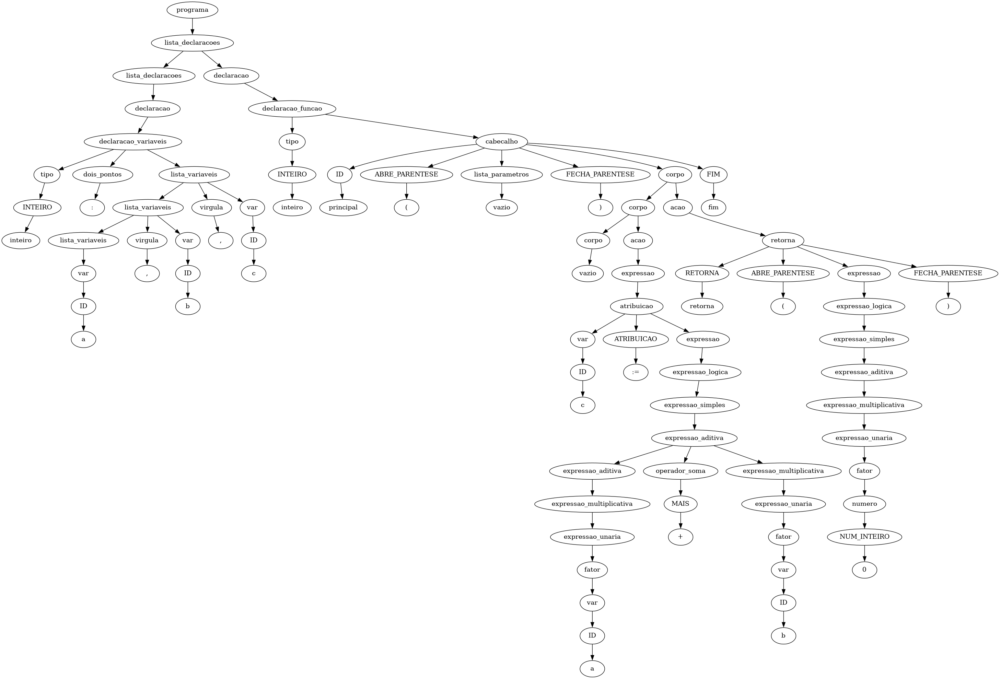

## Projeto de Implementação de um Compilador para a Linguagem **TPP**
### Análise Sintática (Trabalho -- 2a. parte)

#### Prof. Rogério Aparecido Gonçalves

> __Resumo:__ _Este documento apresenta a especificação da 2a. parte do trabalho de implementação da disciplina. O objetivo nessa etapa é projetar e implementar a fase de _Análise Sintática_ do compilador para a linguagem __TPP__. A Análise Sintática é a fase do compilador que recebe a lista de tokens e faz a validação das regras sintáticas da linguagem. O repositório _template_ foi atualizado com o código inicial da implementação dessa fase._

# Análise Sintática

A __Análise Sintática__ determina a sintaxe ou estrutura de um programa. A sintaxe de uma _Linguagem de Programação (LP)_ é normalmente dada pelas __regras gramaticais__ de uma __Gramática Livre de Contexto (GLC)__. Assim como a estrutura léxica é determinada por expressões regulares, uma `GLC` utiliza convenções para nomes e operações muito similares às usadas por expressões regulares. A diferença é que as regras de uma gramática livre de contexto podem ser __recursivas__.

Existem duas categorias gerais de algoritmos para análise sintática: __Análise Sintática Ascendente__ e __Análise Sintática Descendente__. O que determina como é feita a _análise sintática_ e como _árvore sintática_ correspondente é construída.

No processo de Análise Sintática o __Analisador Sintático__ ou __Parser__ é responsável por:

* determinar a estrutura sintática de um programa a partir das __marcas__ (tokens) produzidos pelo processo de __varredura__ (__scanner__, Analisador Léxico)
* construir, explícita ou implicitamente, uma árvore sintática que representa essa estrutura.
* ao final teremos uma Árvore Sintática construída com as derivações das __regras sintáticas__.

* O analisador sintático gera uma árvore sintática pela derivação das regras sintáticas da gramática e é o consumidor da sequência de marcas produzidas pelo _Scanner_ ou processo de  varredura.

## Descrição da Gramática da Linguagem `TPP`

Uma especificação da gramática da Linguagem `TPP` está disponível neste [link](https://docs.google.com/document/d/1e7_M-bD1RUbJAnyR8rZyJ35vKbYEN6KQG4l5L8FQ7_I/edit?usp=sharing)[^3] e são listados no Código \ref{cod:tpp:grammar:rules}.

[^3]:_Gramática da Linguagem TPP:_ [https://docs.google.com/document/d/1e7_M-bD1RUbJAnyR8rZyJ35vKbYEN6KQG4l5L8FQ7_I/edit?usp=sharing](https://docs.google.com/document/d/1e7_M-bD1RUbJAnyR8rZyJ35vKbYEN6KQG4l5L8FQ7_I/edit?usp=sharing)

```{#cod:tpp:grammar:rules .ebnf caption="Regras Gramaticais para TPP"}
programa ::= lista_declaracoes
lista_declaracoes ::= lista_declaracoes declaracao NEWLINE
                      | declaracao NEWLINE
declaracao ::= declaracao_variaveis
              | inicializacao_variaveis
              | declaracao_funcao
declaracao_variaveis ::= tipo DOIS_PONTOS lista_variaveis
                         | tipo DOIS_PONTOS lista_variaveis ATRIBUICAO lista_expressoes
                         | tipo DOIS_PONTOS lista_variaveis ATRIBUICAO atribuicao_encadeada
atribuicao_encadeada ::= var ATRIBUICAO lista_expressoes
                         | var ATRIBUICAO atribuicao_encadeada
inicializacao_variaveis ::= lista_alvos ATRIBUICAO lista_expressoes
                            | ABRE_PARENTESE lista_alvos FECHA_PARENTESE ATRIBUICAO lista_expressoes
lista_variaveis ::= lista_variaveis VIRGULA var
                    | var
var ::= ID 
        | ID indice
indice ::= indice ABRE_COLCHETE expressao FECHA_COLCHETE
          | ABRE_COLCHETE expressao FECHA_COLCHETE
tipo ::= INTEIRO 
         | FLUTUANTE
declaracao_funcao ::= tipo cabecalho
                      | tipos_retorno cabecalho
                      | cabecalho
tipos_retorno ::= ABRE_PARENTESE lista_tipos FECHA_PARENTESE
lista_tipos ::= lista_tipos VIRGULA tipo
                | tipo
cabecalho ::= ID ABRE_PARENTESE lista_parametros FECHA_PARENTESE NEWLINE bloco FIM
lista_parametros ::= lista_parametros VIRGULA parametro 
                     | parametro 
                     | vazio
parametro ::= tipo DOIS_PONTOS ID 
              | parametro ABRE_COLCHETE FECHA_COLCHETE
bloco ::= corpo
          | corpo acao
corpo ::= corpo acao NEWLINE
          | vazio
acao ::= expressao
         | atribuicao
         | declaracao_variaveis
         | se 
         | repita
         | leia 
         | escreva
         | retorna
         | erro
se ::= SE expressao ENTAO bloco FIM
       | SE expressao ENTAO bloco SENAO bloco FIM
repita ::= REPITA bloco ATE expressao
atribuicao ::= lista_expressoes ATRIBUICAO lista_expressoes
               | lista_expressoes ATRIBUICAO atribuicao
lista_alvos ::= lista_alvos VIRGULA var
                | var
lista_expressoes ::= lista_expressoes VIRGULA expressao
                     | expressao
leia ::= LEIA ABRE_PARENTESE var FECHA_PARENTESE
escreva ::= ESCREVA ABRE_PARENTESE expressao FECHA_PARENTESE
retorna ::= RETORNA ABRE_PARENTESE lista_expressoes FECHA_PARENTESE
expressao ::= expressao_logica
expressao_logica ::= expressao_simples
                     | expressao_logica operador_logico expressao_simples
expressao_simples ::= expressao_aditiva
                      | expressao_simples operador_relacional expressao_aditiva
expressao_aditiva ::= expressao_multiplicativa
                      | expressao_aditiva operador_soma expressao_multiplicativa
expressao_multiplicativa ::= expressao_unaria
                             | expressao_multiplicativa operador_multiplicacao expressao_unaria
expressao_unaria ::= fator
                     | operador_soma fator
                     | operador_negacao fator
operador_relacional ::= MENOR
                        | MAIOR 
                        | IGUAL 
                        | DIFERENTE 
                        | MENOR_IGUAL 
                        | MAIOR_IGUAL
operador_soma ::= MAIS
                  | MENOS
operador_logico ::= E
                  | OU
operador_negacao ::= NAO
operador_multiplicacao ::= VEZES 
                           | DIVIDE
fator ::= ABRE_PARENTESE expressao FECHA_PARENTESE
          | var
          | chamada_funcao
          | numero
          | inicializacao_arranjo
          | tupla
tupla ::= ABRE_PARENTESE lista_expressoes VIRGULA expressao FECHA_PARENTESE
inicializacao_arranjo ::= ABRE_CHAVE lista_expressoes FECHA_CHAVE
numero ::= NUM_INTEIRO
           | NUM_PONTO_FLUTUANTE
           | NUM_NOTACAO_CIENTIFICA
chamada_funcao ::= ID ABRE_PARENTESE lista_argumentos FECHA_PARENTESE
lista_argumentos  ::= lista_argumentos VIRGULA expressao
                      | expressao
                      | vazio
```

## Instruções Gerais

1. Para obter o código inicial para a segunda fase, __Análise Sintática__. Se não fez a configuração do repositório oficial do professor como `upstream` na primeira parte, faça a configuração. Esse configuração deve ser feita apenas uma vez, conforme o @lst:comandos:iniciais.

```{#lst:comandos:iniciais .bash caption="Comandos de configuração do repositório"}
# Conectar o repositório oficial do professor como 'upstream'.
git remote add upstream https://github.com/rogerioag/tppcompiler-code-start.git

# Obter os arquivos para a fase 2, Análise Sintática.
git fetch upstream
   git merge upstream/main -m "Merge upstream Fase 2 - Sintático"
   git push origin main
```

2. Siga a estrutura fornecida para desenvolver o trabalho, pois será a mesma estrutura que deverá ser entregue ao final do projeto. Nas outras fases iremos adicionar outras partes do projeto nesse repositório.

Se a obtenção do código da nova fase funcionou, o diretório: `src/tppparser/` foi adicionado ao repostório do seu projeto, é nesse diretório que tem os arquivos que você irá trabalhar na análise sintática. Ao terminar a implementação envie para o seu `github`, conforme o @lst:comandos:envio.

```{#lst:comandos:envio .bash caption="Comandos de envio para o github"}
git add .
git commit -m "feat: Implementação da Análise Sintática"
git push origin main
```

3. Após o envio para o seu `github`, acesse o link <https://github.com/<seulogin-github/tppcompiler-seulogin-github/actions> e verifique o resultado da execução dos testes. Se algum teste falhar, corrija o problema e repita o processo. Os testes podem ser executados localmente com o comando: `pytest -v tests/tppparser_test.py`.

4. Prepare o relatório com a descrição do trabalho e da implementação e exemplos de entrada e saída gerada pelo Analisador Sintático.

5. Deverá ser entregue o repositório compactado via moodle, conforme descrito na [Seção @sec:tpp:doc:entrega]. Com o código fonte da implementação completa e o relatório em **pdf** no formato de artigo conforme o modelo descrito na [Seção @sec:tpp:doc:entrega].

6. O projeto deve seguir a estrutura de diretórios e arquivos, disponível no repositório.

7. O relatório dessa segunda fase, deve conter o conteúdo da primeira parte, Análise Léxica e conteúdo relacionado a esta segunda fase, Análise Sintática, incluindo exemplos de entrada e saída gerada pelo Analisador Sintático.

8. Deverão ser entregues:
	a) O código fonte da implementação.
	b) Relatório em **pdf** que pode ser feito no formato do `LibreOffice` ou no `Latex`.

5. O projeto deve seguir a estrutura de diretórios e arquivos, disponível no formato. A estrutura do projeto é apresentada na Figura \ref{fig:formato:entrega}.


## Implementação

A implementação da _Análise Sintática_ deverá ser realizando utilizando o mesmo conjunto de ferramentas compatíveis utilizado na Análise Léxica. O código base para a implementação está disponível no link [Código de Start](https://moodle.utfpr.edu.br/mod/url/view.php?id=1733830) do Moodle.

A análise sintática deverá ser implementada baseada em uma descrição formal da Gramática da Linguagem `TPP` (GLC - Gramática Livre de Contexto) presenta na documentação. A lista de símbolos analisados sintaticamente poderão ser obtidos da implementação da Análise Léxica.

A estrutura da __Árvore Sintática__ será montada nessa fase. Para cada uma das regras sintáticas deverá ser observado a necessidade de adicionar um nó na árvore sintática correspondente à derivação da regra. Como resultado da implementação desta parte do trabalho, uma **árvore sintática** (AST) estruturando todo o código fonte do arquivo de entrada deverá ser montada. O Código \ref{cod:exemplo:tpp} apresenta um exemplo de um arquivo de entrada.

```{#cod:exemplo:tpp .pascal caption="Exemplo de Código de Entrada"}
inteiro: a, b, c

inteiro principal()
  c := a + b
  retorna(0)
fim
```

A Árvore gerada com resultado do processo de Análise Sintática para o exemplo do Código \ref{cod:exemplo:tpp} é apresentada na Figura \ref{fig:ast:exemplo}.



## Linguagens de programação para a implementação

Para a implementação do compilador, pode ser utilizado qualquer linguagem de programação[^1]. É recomendado que seja utilizado uma linguagem que dê suporte à estruturas de dados de alto nível e preferencialmente que exista bibliotecas para a construção da varredura e gramática. Algumas LPs/ferramentas conhecidas são:

[^1]: Que tenha suporte às ferramentas de especificação do sistema de varredura e da gramática e que também tenha suporte ao [LLVM](http://llvm.org).

* `C/C++ - Flex/Bison` [@paxson1995flex], [@bison]
* `Python - PLY` (que possui ferramenta Léxica e Sintática) [@ply]
* `Java - JFlex/Jacc` [@jflex2020], [@jacc]

**Obs.:** A implementação de referência será apresentada na linguagem `Python`.

Para essa fase serão necessárias as instalações das bibliotecas do `Python`:

* `Anytree`: <https://pypi.org/project/anytree/> para a implementação da árvore sintática.

* `Graphviz`: <https://pypi.org/project/graphviz/> para a gerar a figura da árvore.


## Testes

Alguns casos de testes estão disponíveis no moodle institucional junto com essa especificação no código inicial fornecido. O `GitHub Actions` executará os testes automaticamente. Serão executados esses testes e outros testes que o professor julgar necessário durante a avaliação desta parte do trabalho.

* __Parser:__ programa de exemplo `TPP` de **entrada** na linha de comando. 
* __Saída:__ Árvore Sintática e uma lista de erros que foram identificados.

No [Código Start da Sintática](https://moodle.utfpr.edu.br/mod/url/view.php?id=1733830) tem um diretório `tests/syn-tests` com os testes para a _Análise Sintática_.

É necessário terminar o desenvolvimento da parte de tratamento de erros. Está sendo disponibilizado uma classe de tratamento de erros que será utilizada em todas as fases do projeto, a `myerror.py` que carrega uma lista de erros composta por pares (chave:valor) formada por _códigos de erros_ e as _mensagens de erros_ correspondentes.

Para que os testes possam ser automatizados foi disponibilizado um arquivo padrão que o `Github` utiliza para executar os testes a cada `commit` realizado. O sistema executa o `tests/tppparser_test.py` que chama o `src/tpp_compiler.py --parser yacc` da sua implementação com cada um dos arquivos de teste e compara se a saída produzida é a mesma saída esperada.

```python
import pytest
import subprocess
import shlex
import os, fnmatch

def pytest_generate_tests(metafunc):
    """Gera dinamicamente os casos de teste com base na opção --parser."""
    parser_opt = metafunc.config.getoption("parser")

    if parser_opt == "all":
        parsers = ["yacc"]
    else:
        parsers = [parser_opt]

    # Testes para se passar um arquivo em branco, um arquivo com outra extensão e um arquivo .tpp que não existe.
    cases = []
    for parser in parsers:
        cases.append((parser, "-k", ""))
        cases.append((parser, "-k", "teste.c"))
        cases.append((parser, "-k", "notexist.tpp"))

    # Arquivos de teste .tpp
    files = sorted(fnmatch.filter(os.listdir('tests/syn-tests/'), '*.tpp'))
    for file in files:
        for parser in parsers:
            cases.append((parser, "-k", file))

    metafunc.parametrize("parser_type, key_option, input_file", cases)


# @pytest.mark.parametrize("parser_type, key_option, input_file", test_cases)
def test_execute(parser_type, key_option, input_file):
    if(input_file != ''):
        path_file = 'tests/syn-tests/' + input_file
    else:
        path_file = ""

    # Executa o comando de compilação. O -t gera a árvore sintática (e os arquivos
    # .ast.dot, .unique.ast.dot, .unique.ast.png e ascii_tree.txt ao lado do .tpp).
    cmd = "python src/tpp_compiler.py --parser {0} {1} -t {2}".format(parser_type, key_option, path_file)

    process = subprocess.Popen(shlex.split(cmd), stdout=subprocess.PIPE, stderr=subprocess.PIPE)

    stdout, stderr = process.communicate()
    stdout, stderr

    path_file = 'tests/syn-tests/' + input_file
    output_file = open(path_file + ".syn.out", "r")

    #read whole file to a string
    expected_output = output_file.read()

    output_file.close()

    print("Generated output:")
    print(stdout)
    print("Expected output:")
    print(expected_output)

    assert stdout.decode("utf-8").strip() == expected_output.strip()


if __name__ == "__main__":
    import sys
    sys.exit(pytest.main(sys.argv[1:] + [__file__]))

```

```
[rag@backporting tppcompiler-code-start]$ pytest tests/tppparser_test.py -v
====================================================================================== test session starts ======================================================================================
platform linux -- Python 3.14.8, pytest-9.1.1, pluggy-1.7.0 -- /usr/bin/python
cachedir: .pytest_cache
rootdir: /run/media/rag/DADOS/repositorios/Dropbox/dados/rogerio/projetos/projetos.github/tppcompiler-code-start
plugins: anyio-4.13.0, platformdirs-4.13.5
collected 84 items                                                                                                                                                                              

tests/tppparser_test.py::test_execute[yacc--k-] PASSED                                                                                                                                    [  1%]
tests/tppparser_test.py::test_execute[yacc--k-teste.c] PASSED                                                                                                                             [  2%]
tests/tppparser_test.py::test_execute[yacc--k-notexist.tpp] PASSED                                                                                                                        [  3%]
tests/tppparser_test.py::test_execute[yacc--k-syn-test-001.tpp] PASSED                                                                                                                    [  4%]
tests/tppparser_test.py::test_execute[yacc--k-syn-test-002.tpp] PASSED                                                                                                                    [  5%]
tests/tppparser_test.py::test_execute[yacc--k-syn-test-003.tpp] PASSED                                                                                                                    [  7%]
tests/tppparser_test.py::test_execute[yacc--k-syn-test-004.tpp] PASSED                                                                                                                    [  8%]
tests/tppparser_test.py::test_execute[yacc--k-syn-test-005.tpp] PASSED                                                                                                                    [  9%]
tests/tppparser_test.py::test_execute[yacc--k-syn-test-006.tpp] PASSED                                                                                                                    [ 10%]
tests/tppparser_test.py::test_execute[yacc--k-syn-test-007.tpp] PASSED                                                                                                                    [ 11%]
tests/tppparser_test.py::test_execute[yacc--k-syn-test-008.tpp] FAILED                                                                                                                    [ 13%]
tests/tppparser_test.py::test_execute[yacc--k-syn-test-009.tpp] FAILED                                                                                                                    [ 14%]
tests/tppparser_test.py::test_execute[yacc--k-syn-test-010.tpp] FAILED                                                                                                                    [ 15%]
tests/tppparser_test.py::test_execute[yacc--k-syn-test-011.tpp] FAILED                                                                                                                    [ 16%]
tests/tppparser_test.py::test_execute[yacc--k-syn-test-012.tpp] FAILED                                                                                                                    [ 17%]
tests/tppparser_test.py::test_execute[yacc--k-syn-test-013.tpp] FAILED                                                                                                                    [ 19%]
tests/tppparser_test.py::test_execute[yacc--k-syn-test-014.tpp] FAILED                                                                                                                    [ 20%]
tests/tppparser_test.py::test_execute[yacc--k-syn-test-015.tpp] PASSED                                                                                                                    [ 21%]
tests/tppparser_test.py::test_execute[yacc--k-syn-test-016.tpp] FAILED                                                                                                                    [ 22%]
tests/tppparser_test.py::test_execute[yacc--k-syn-test-017.tpp] PASSED                                                                                                                    [ 23%]
tests/tppparser_test.py::test_execute[yacc--k-syn-test-018.tpp] FAILED                                                                                                                    [ 25%]
tests/tppparser_test.py::test_execute[yacc--k-syn-test-019.tpp] PASSED                                                                                                                    [ 26%]
tests/tppparser_test.py::test_execute[yacc--k-syn-test-020.tpp] PASSED                                                                                                                    [ 27%]
tests/tppparser_test.py::test_execute[yacc--k-syn-test-021.tpp] PASSED                                                                                                                    [ 28%]
tests/tppparser_test.py::test_execute[yacc--k-syn-test-022.tpp] PASSED                                                                                                                    [ 29%]
tests/tppparser_test.py::test_execute[yacc--k-syn-test-023.tpp] PASSED                                                                                                                    [ 30%]
tests/tppparser_test.py::test_execute[yacc--k-syn-test-024.tpp] PASSED                                                                                                                    [ 32%]
tests/tppparser_test.py::test_execute[yacc--k-syn-test-025.tpp] PASSED                                                                                                                    [ 33%]
tests/tppparser_test.py::test_execute[yacc--k-syn-test-026.tpp] PASSED                                                                                                                    [ 34%]
tests/tppparser_test.py::test_execute[yacc--k-syn-test-027.tpp] PASSED                                                                                                                    [ 35%]
tests/tppparser_test.py::test_execute[yacc--k-syn-test-028.tpp] PASSED                                                                                                                    [ 36%]
tests/tppparser_test.py::test_execute[yacc--k-syn-test-029.tpp] PASSED                                                                                                                    [ 38%]
tests/tppparser_test.py::test_execute[yacc--k-syn-test-030.tpp] PASSED                                                                                                                    [ 39%]
tests/tppparser_test.py::test_execute[yacc--k-syn-test-031.tpp] PASSED                                                                                                                    [ 40%]
tests/tppparser_test.py::test_execute[yacc--k-syn-test-032.tpp] PASSED                                                                                                                    [ 41%]
tests/tppparser_test.py::test_execute[yacc--k-syn-test-033.tpp] PASSED                                                                                                                    [ 42%]
tests/tppparser_test.py::test_execute[yacc--k-syn-test-034.tpp] PASSED                                                                                                                    [ 44%]
tests/tppparser_test.py::test_execute[yacc--k-syn-test-035.tpp] PASSED                                                                                                                    [ 45%]
tests/tppparser_test.py::test_execute[yacc--k-syn-test-036.tpp] PASSED                                                                                                                    [ 46%]
tests/tppparser_test.py::test_execute[yacc--k-syn-test-037.tpp] PASSED                                                                                                                    [ 47%]
tests/tppparser_test.py::test_execute[yacc--k-syn-test-038.tpp] PASSED                                                                                                                    [ 48%]
tests/tppparser_test.py::test_execute[yacc--k-syn-test-039.tpp] PASSED                                                                                                                    [ 50%]
tests/tppparser_test.py::test_execute[yacc--k-syn-test-040.tpp] PASSED                                                                                                                    [ 51%]
tests/tppparser_test.py::test_execute[yacc--k-syn-test-041.tpp] PASSED                                                                                                                    [ 52%]
tests/tppparser_test.py::test_execute[yacc--k-syn-test-042.tpp] PASSED                                                                                                                    [ 53%]
tests/tppparser_test.py::test_execute[yacc--k-syn-test-043.tpp] PASSED                                                                                                                    [ 54%]
tests/tppparser_test.py::test_execute[yacc--k-syn-test-044.tpp] FAILED                                                                                                                    [ 55%]
tests/tppparser_test.py::test_execute[yacc--k-syn-test-045.tpp] PASSED                                                                                                                    [ 57%]
tests/tppparser_test.py::test_execute[yacc--k-syn-test-046.tpp] PASSED                                                                                                                    [ 58%]
tests/tppparser_test.py::test_execute[yacc--k-syn-test-047.tpp] PASSED                                                                                                                    [ 59%]
tests/tppparser_test.py::test_execute[yacc--k-syn-test-048.tpp] PASSED                                                                                                                    [ 60%]
tests/tppparser_test.py::test_execute[yacc--k-syn-test-049.tpp] PASSED                                                                                                                    [ 61%]
tests/tppparser_test.py::test_execute[yacc--k-syn-test-050.tpp] PASSED                                                                                                                    [ 63%]
tests/tppparser_test.py::test_execute[yacc--k-syn-test-051.tpp] PASSED                                                                                                                    [ 64%]
tests/tppparser_test.py::test_execute[yacc--k-syn-test-052.tpp] PASSED                                                                                                                    [ 65%]
tests/tppparser_test.py::test_execute[yacc--k-syn-test-053.tpp] PASSED                                                                                                                    [ 66%]
tests/tppparser_test.py::test_execute[yacc--k-syn-test-054.tpp] PASSED                                                                                                                    [ 67%]
tests/tppparser_test.py::test_execute[yacc--k-syn-test-055.tpp] PASSED                                                                                                                    [ 69%]
tests/tppparser_test.py::test_execute[yacc--k-syn-test-056.tpp] PASSED                                                                                                                    [ 70%]
tests/tppparser_test.py::test_execute[yacc--k-syn-test-057.tpp] PASSED                                                                                                                    [ 71%]
tests/tppparser_test.py::test_execute[yacc--k-syn-test-058.tpp] PASSED                                                                                                                    [ 72%]
tests/tppparser_test.py::test_execute[yacc--k-syn-test-059.tpp] PASSED                                                                                                                    [ 73%]
tests/tppparser_test.py::test_execute[yacc--k-syn-test-060.tpp] PASSED                                                                                                                    [ 75%]
tests/tppparser_test.py::test_execute[yacc--k-syn-test-061.tpp] PASSED                                                                                                                    [ 76%]
tests/tppparser_test.py::test_execute[yacc--k-syn-test-062.tpp] PASSED                                                                                                                    [ 77%]
tests/tppparser_test.py::test_execute[yacc--k-syn-test-063.tpp] PASSED                                                                                                                    [ 78%]
tests/tppparser_test.py::test_execute[yacc--k-syn-test-064.tpp] PASSED                                                                                                                    [ 79%]
tests/tppparser_test.py::test_execute[yacc--k-syn-test-065.tpp] PASSED                                                                                                                    [ 80%]
tests/tppparser_test.py::test_execute[yacc--k-syn-test-066.tpp] PASSED                                                                                                                    [ 82%]
tests/tppparser_test.py::test_execute[yacc--k-syn-test-067.tpp] PASSED                                                                                                                    [ 83%]
tests/tppparser_test.py::test_execute[yacc--k-syn-test-068.tpp] PASSED                                                                                                                    [ 84%]
tests/tppparser_test.py::test_execute[yacc--k-syn-test-069.tpp] PASSED                                                                                                                    [ 85%]
tests/tppparser_test.py::test_execute[yacc--k-syn-test-070.tpp] PASSED                                                                                                                    [ 86%]
tests/tppparser_test.py::test_execute[yacc--k-syn-test-071.tpp] PASSED                                                                                                                    [ 88%]
tests/tppparser_test.py::test_execute[yacc--k-syn-test-072.tpp] PASSED                                                                                                                    [ 89%]
tests/tppparser_test.py::test_execute[yacc--k-syn-test-073.tpp] PASSED                                                                                                                    [ 90%]
tests/tppparser_test.py::test_execute[yacc--k-syn-test-074.tpp] PASSED                                                                                                                    [ 91%]
tests/tppparser_test.py::test_execute[yacc--k-syn-test-075.tpp] PASSED                                                                                                                    [ 92%]
tests/tppparser_test.py::test_execute[yacc--k-syn-test-076.tpp] PASSED                                                                                                                    [ 94%]
tests/tppparser_test.py::test_execute[yacc--k-syn-test-077.tpp] PASSED                                                                                                                    [ 95%]
tests/tppparser_test.py::test_execute[yacc--k-syn-test-078.tpp] PASSED                                                                                                                    [ 96%]
tests/tppparser_test.py::test_execute[yacc--k-syn-test-079.tpp] PASSED                                                                                                                    [ 97%]
tests/tppparser_test.py::test_execute[yacc--k-syn-test-080.tpp] FAILED                                                                                                                    [ 98%]
tests/tppparser_test.py::test_execute[yacc--k-syn-test-081.tpp] PASSED                                                                                                                    [100%]

=========================================================================================== FAILURES ============================================================================================
____________________________________________________________________________ test_execute[yacc--k-syn-test-008.tpp] _____________________________________________________________________________

parser_type = 'yacc', key_option = '-k', input_file = 'syn-test-008.tpp'

    def test_execute(parser_type, key_option, input_file):
        if(input_file != ''):
            path_file = 'tests/syn-tests/' + input_file
        else:
            path_file = ""
    
        # Executa o comando de compilação. O -t gera a árvore sintática (e os arquivos
        # .ast.dot, .unique.ast.dot, .unique.ast.png e ascii_tree.txt ao lado do .tpp).
        cmd = "python src/tpp_compiler.py --parser {0} {1} -t {2}".format(parser_type, key_option, path_file)
    
        process = subprocess.Popen(shlex.split(cmd), stdout=subprocess.PIPE, stderr=subprocess.PIPE)
    
        stdout, stderr = process.communicate()
        stdout, stderr
    
        path_file = 'tests/syn-tests/' + input_file
        output_file = open(path_file + ".syn.out", "r")
    
        #read whole file to a string
        expected_output = output_file.read()
    
        output_file.close()
    
        print("Generated output:")
        print(stdout)
        print("Expected output:")
        print(expected_output)
    
>       assert stdout.decode("utf-8").strip() == expected_output.strip()
E       AssertionError: assert 'ERR-SYN-EOF-INESPERADO' == 'ERR-SYN-EOF-...N-SYNTAX-TREE'
E         
E         - ERR-SYN-EOF-INESPERADO
E         ?                       -
E         + ERR-SYN-EOF-INESPERADO
E         - ERR-SYN-IRRECUPERAVEL
E         - WAR-SYN-NOT-GEN-SYNTAX-TREE

tests/tppparser_test.py:60: AssertionError
{...}
```

A ideia é que em uma _execução normal_ as mensagens de erros sejam recuperadas e impressas na saída padrão (terminal).

<!--

\newpage

Exemplo de saída para teste sem erros em _execução normal_:

[columns]

[column=0.5]

Arquivo: `teste-001.tpp`

```txt
inteiro: a,b
```

Execução:

```bash
$ python3 tppparser.py teste-001.tpp
```

[column=0.5]

Saída gerada:

```txt
INTEIRO
DOIS_PONTOS
ID
VIRGULA
ID
```

[/columns]


Exemplo de saída para teste com erro em _execução normal_:

[columns]

[column=0.5]

Arquivo: `teste-002.tpp`

```txt
inteiro: a,b
ç
```

Execução:

```bash
$ python3 tpplex.py teste-002.tpp
```

[column=0.5]

Saída gerada:

```txt
INTEIRO
DOIS_PONTOS
ID
VIRGULA
ID
Erro[02][01]: Caracter inválido: ç
```

[/columns]

-->

Já em uma _execução de testes automatizados_ seja fornecido um parâmetro `-k` que imprima o código de erro apenas, possibilitando que o código apareça entre os _tokens_ da lista de _tokens_ gerada para o arquivo de entrada.

<!--

Exemplo de saída para teste sem erros em _execução de testes automatizados_:

[columns]

[column=0.5]

Arquivo: `teste-001.tpp`

```txt
inteiro: a,b
```

Execução:

```bash
$ python3 tpplex.py -k teste-001.tpp
```

[column=0.5]

Saída gerada:

```txt
INTEIRO
DOIS_PONTOS
ID
VIRGULA
ID
```

[/columns]


Exemplo de saída para teste com erros em _execução de testes automatizados_:

[columns]

[column=0.5]

Arquivo: `teste-002.tpp`

```txt
inteiro: a,b
ç
```

Execução:

```bash
$ python3 tpplex.py -k teste-001.tpp
```

[column=0.5]

Saída gerada:

```txt
INTEIRO
DOIS_PONTOS
ID
VIRGULA
ID
ERR-LEX-INV-CHAR
```

[/columns]
-->

O arquivo `ParserErrorMessages.properties` foi atualizado com a seção de erros e avisos para a _Sintática_:

```text
[ParserErrors]
WAR-SYN-GEN-SYNTAX-TREE=Generating Syntax Tree Graph.
WAR-SYN-NOT-GEN-SYNTAX-TREE=Não foi possível gerar a Árvore Sintática.
ERR-SYN-IRRECUPERAVEL=Estado irrecuperável.
WAR-SYN-ANA-SUCCESS=Análise Sintática Executada com Sucesso. Gráfico da Árvore foi gerado.
ERR-SYN-LISTA-ARGUMENTOS=Erro na lista de Argumentos.
ERR-SYN-INDICE=Erro na definicao do indice. Expressao ou indice.
ERR-SYN-EOF-INESPERADO=Erro inesperado.
WAR-SYN-OUTPUT-FILE=Output
ERR-SYN-LEIA=Uso incorreto da função 'leia'.
ERR-SYN-PARAMETRO=Declaração incorreta de parâmetro de função.
ERR-SYN-CABECALHO=Erro na declaração do cabeçalho.
```

Para a regra `lista_argumentos : lista_argumentos VIRGULA expressao | expressao | vazio` da `EBNF` que está impleentada na função `p_lista_argumentos(p)` no arquivo `src/tppparser/grammar/expressions.py:

```ebnf
def p_lista_argumentos(p):
    """lista_argumentos : lista_argumentos VIRGULA expressao
                    | expressao
                    | vazio
        """
    pai = MyNode(name='lista_argumentos', type='LISTA_ARGUMENTOS')
    p[0] = pai

    if len(p) > 2:
        p[1].parent = pai

        filho2 = MyNode(name='VIRGULA', type='VIRGULA', parent=pai)
        filho_sym = MyNode(name=p[2], type='SIMBOLO', parent=filho2)
        p[2] = filho2

        p[3].parent = pai
    else:
        p[1].parent = pai
```

O tratamento de erro será feito na implementação de uma função com o mesmo nome adicionado do sufixo `_error` e com a definição de uma regra contendo a marcação da posição do _erro_ com o identificador `error`:

```
def p_lista_argumentos_error(p):
    """lista_argumentos : error VIRGULA expressao
        """
    print(estado.error_handler.newError(estado.check_key, 'ERR-SYN-LISTA-ARGUMENTOS'))
    
    error_line = p.lineno(2)
    father = MyNode(name='ERR-SYN-LISTA-ARGUMENTOS::{}'.format(error_line), type='ERROR')
    logging.error(
        "Syntax error parsing index rule at line {}".format(error_line))
    p.parser.errok()
    p[0] = father
```

As funções para as regras de tratamento de erro podem estar no mesmo arquivo de definição das funções ou em um arquivo separado. Estar no mesmo arquivo facilita o desenvolvimento, mas podem ser colocadas em um arquivo separado dependendo do tamanho da gramática.

O padrão de nomes da chaves de erros deve considerar o nome da função que está sendo tratada. Do exemplo anterior, para a função `p_lista_argumentos_error` deverá ser emitida a chave de erro `ERR-SYN-LISTA-ARGUMENTOS`. Caso tenhamos mais de um erro a ser levantado na mesma função, deve ser tratado.

Na impressão feita pela classe `MyError`, que foi definida no arquivo `myerror.py`, a distinção entre erros e avisos deve ser feita.

## Documentação

Durante toda a disciplina o aluno criará uma documentação formal da implementação do compilador para a linguagem. Sendo os relatório com conteúdo acumulativo, isto é, as fases subsequentes irão complementar o conteúdo existente das fases anteriores. 

Para a fase de __Análise Sintática__, a documentação deve apresentar os seguintes itens:

- A descrição da Gramática no padrão BNF.
- Discussão sobre o formato na Análise Sintática realizado pela ferramenta (se é LL(1), LR(1), LALR(1), SLR(1), etc).
- Discussão sobre a implementação e utilização da ferramenta `Yacc`.
- Discussão sobre implementação da Árvore Sintática.
- Discussão sobre o tratamento de erros.
- Discussão sobre Testes.

O relatório deve ser escrito no formato de artigo[^2] disponível no [link](https://www.overleaf.com/read/fcqmjkfgktgt), faça uma cópia para seu `Overleaf`. O número mínimo em cada etapa é de $8$ a $12 páginas.

[^2]: [Formato para o relatório: https://www.overleaf.com/read/fcqmjkfgktgt](https://www.overleaf.com/read/fcqmjkfgktgt)

## Avaliação

A avaliação da Análise Sintática será realizada da seguinte forma:

Programa de exemplo `TPP` de **entrada** na linha de comando. **Saída** será a validação da análise sintática. Além disto uma **representação da árvore sintática** (AST) do código fonte analisado deverá ser gerada. A saída da análise sintática por meio de uma AST é de extrema importância para a continuação da terceira parte do trabalho (Análise Semântica). Deverá ser possível verificar erros `shift-reduce` e `reduce-reduce` (debuggers deverão estar ativos para a realização da avaliação).

É importante que uma classe de análise de erros já esteja preparada. Os erros mais comuns em desenvolvimento de programas estão relacionados com a Análise Sintática.

* Serão avaliados, dentre outros critérios:
	a) Da implementação:
		+ O funcionamento do programa.
		+ O capricho e a organização na elaboração do projeto.
		+ A corretude da implementação em relação ao que foi pedido no trabalho.
		+ A colocação em prática dos conceitos que foram discutidos em sala de aula de forma correta.
		+ A qualidade do projeto e da implementação (descrição e elaboração do projeto e o passo a passo da implementação).

 	b) Do relatório:
 		+ O conteúdo e a forma que foi apresentado, se o formato é o mesmo solicitado.
 		+ Organização das ideias e do processo de tradução.
 		+ O capricho na elaboração e na formatação do texto, bem como o conteúdo do texto.

* Não serão avaliados os trabalhos:
	a) Que chegarem fora do prazo.
 	b) Que não forem feitos nas ferramentas solicitadas.
 	c) Que não estão no formato especificado.
 	d) Que não foram compactados em um só arquivo.
 	e) Que não tiverem identificação (nome e matrícula).
    f) Que forem cópias de outros trabalhos ou materiais da internet.
 	g) Que não seguirem todas estas instruções.

* Não se esqueça que o trabalho vale **10,0** e contribui para o cálculo da nota final.

## Entrega e Apresentação

O trabalho será **individual** e deverá ser entregue até o dia **05/11/2026** no moodle da disciplina em um pacote compactado. A estrutura do projeto com os arquivos do projeto (fonte e relatório) deve ser compactada (zipados) e o arquivo compactado deve ser enviado pelo moodle utilizando a opção de submissão __"Trabalho 2a. parte - Análise Sintática"__, o nome do arquivo compactado deve seguir o padrão de nomes do formato.

Deverá ser especificado na entrega o mecanismo de execução do *parser* para a realização da correção.

**Obs.:** Favor utilizar ZIP como forma de compactação.

## Leitura Recomendada {.allowframebreaks}


[alertblock]{Leitura Recomendada}

__Capítulo 3: Gramáticas Livres de Contexto e Análise Sintática__

**Livro**: [`LOUDEN, Kenneth C. Compiladores: principios e praticas. Sao Paulo, SP: Thomson, c2004. xiv, 569 p. ISBN 8522104220.`](https://integrada.minhabiblioteca.com.br/reader/books/9788522128532/pageid/109)

[/alertblock]

[exampleblock]{Leitura Recomendada}

__Capítulo 3: Análise Sintática__

**Livro**: [`AHO, Alfred V. et al. Compiladores: principios, tecnicas e ferramentas. 2. ed. Sao Paulo, SP: Pearson Addison-Wesley, 2008. x, 634 p. ISBN 9788588639249.`](https://integrada.minhabiblioteca.com.br/#/books/9788588639249/pageid/122)

[/exampleblock]

[block]{Leitura Recomendada}

__Capítulo 3: Analisadores Sintáticos (Parsers)__

**Livro**: [`COOPER, Keith D.; TORCZON, Linda. Construindo compiladores. Rio de Janeiro, RJ: Elsevier/Campus, 2014. xxiv, 656 p. ISBN 9788535255645. Disponível em: https://research.ebsco.com/linkprocessor/plink?id=debd0a1f-ba89-3ee8-b0a1-2c929486cc51. Acesso em: 12 mar. 2024.`](https://integrada.minhabiblioteca.com.br/#/books/9781558606982/pageid/69)

[/block]

## _Word Cloud_

{ width=100% }

## Referências {.fragile .allowframebreaks}
